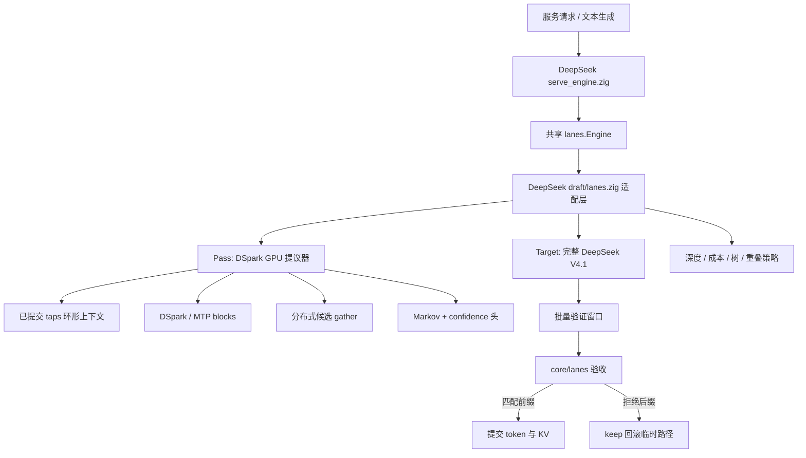
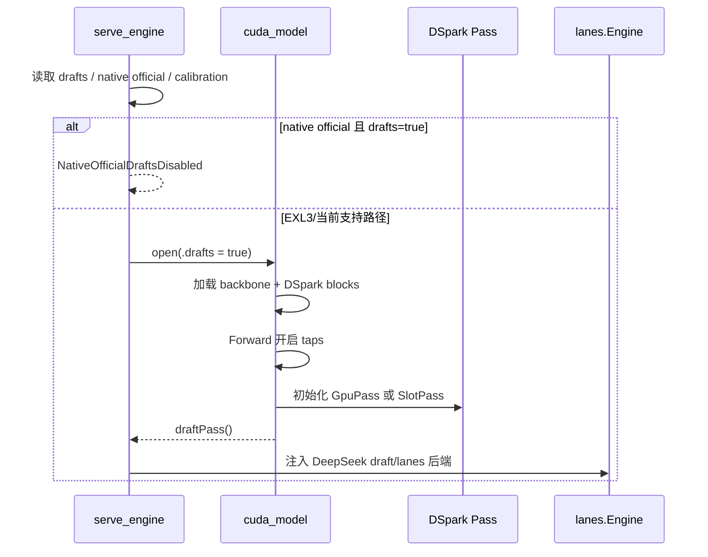
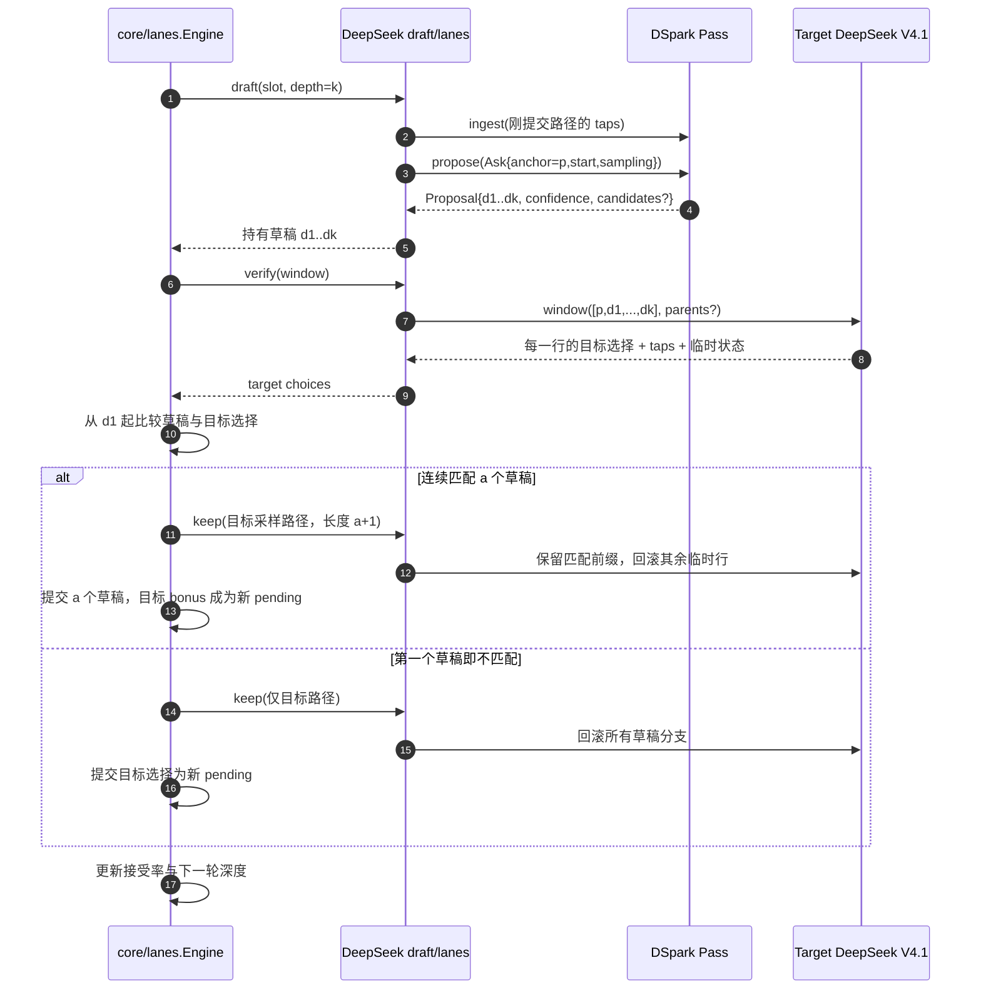

# TensorFold 中 DeepSeek V4.1 DSpark 投机解码处理逻辑

> 本文描述当前仓库中 DeepSeek V4.1 + DSpark 的实际代码链路。重点是“一次文本解码轮次如何执行”，以及 DSpark、目标模型、共享 lanes 调度器分别负责什么。文中的 DSpark 是提议器（drafter），目标模型始终是最终正确性判定者。

## 1. 结论摘要

TensorFold 没有让 DSpark 直接产出最终文本，而是把它接入统一的 `lanes.Engine`：

1. 目标模型先产生或持有当前 pending token，并提供最近已提交 token 对应的隐藏状态 taps。
2. DSpark 根据 pending token、最多 128 个历史 taps、Markov 头和采样参数，一次提出最多 5 个草稿 token。
3. 下一轮把 `[pending, draft_1, ..., draft_k]` 作为一个验证窗口交给完整 DeepSeek V4.1 目标模型。
4. 共享 lanes 从前向后比较“DSpark 草稿”和“目标模型在对应位置的选择”，只接受连续匹配前缀。
5. 首个不匹配位置立即终止接受；目标模型的选择成为新的 pending token，未接受的临时 KV/状态通过 `keep(path)` 回滚。
6. 实际草稿深度并不固定为 5。深度策略依据校准成本和近期接受率，在 0～5 之间动态选择。

因此，DSpark 影响吞吐量和每轮验证宽度，但不改变最终 token 的目标模型语义。

## 2. 代码责任分层



| 层 | 主要文件 | 职责 |
|---|---|---|
| 服务装配 | `zig/src/families/deepseek_v41/serve_engine.zig` | 读取 drafts 开关、加载成本校准、创建 DeepSeek lanes 后端并接入共享引擎 |
| 模型与 GPU 装配 | `zig/src/families/deepseek_v41/cuda_model.zig` | 加载 DSpark blocks、taps、GPU pass、单/多 slot pass，向 Target 注入 draft pass |
| DeepSeek 适配 | `zig/src/families/deepseek_v41/draft/lanes.zig` | 把通用 verify/draft/keep 生命周期映射到 DeepSeek Target 与 DSpark Pass |
| DSpark 算法 | `draft/dspark.zig`、GPU pass 相关实现 | 上下文组织、候选排序、Markov 链、confidence、采样 |
| 接口契约 | `draft/iface.zig` | `Target`、`Pass`、`Segment`、`Ask`、`Proposal`、`Taps` 的 vtable 与数据布局 |
| 通用调度 | `zig/src/core/lanes/engine.zig` | 请求生命周期、共享批处理、目标验证、提交、回滚和统计 |
| 接受算法 | `zig/src/core/lanes/accept.zig` | 链式或树式草稿的目标路径选择 |
| 动态深度 | `zig/src/core/lanes/depth.zig`、`draft/depth.zig` | 依据成本和接受率决定每轮草稿数 |
| 可选重叠 | `draft/spec.zig` | 在当前轮提交/控制逻辑期间提前启动下一次 DSpark pass |

## 3. DSpark 相关模型配置

DeepSeek V4.1 配置由 `zig/src/families/deepseek_v41/config.zig` 解析；当前 Flash 1017 fixture 中关键字段如下：

| 配置 | 当前值 | 含义 |
|---|---:|---|
| `num_nextn_predict_layers` | 3 | DSpark/MTP 预测层数量 |
| `dspark_block_size` | 5 | 单次最多提出 5 个连续草稿 token |
| `dspark_noise_token_id` | 128799 | DSpark block 中除 anchor 外的占位/噪声 token |
| `dspark_target_layer_ids` | `[37, 38, 39]` | DSpark 使用的目标层 taps 来源 |
| `dspark_markov_rank` | 256 | Markov 低秩头维度 |
| `dspark_n_routed_experts` | 128 | DSpark MoE routed expert 数量 |
| `dspark_num_experts_per_tok` | 3 | 每个 token 选择的 DSpark experts 数 |
| DSpark context window | 128 | 每个 slot 最多保留的已提交 taps 行数 |

`Config.allLayers()` 会把 backbone 层与 MTP/DSpark 层统一纳入模型加载计划；`expertsOf()` 对 MTP block 使用 DSpark 自己的 expert 数量与 top-k，而不是直接沿用 backbone MoE 参数。

## 4. 启用与初始化



关键限制：当前 `native official` 混合路径明确禁用 drafts。也就是说，本文 DSpark 流程适用于当前支持草稿的 DeepSeek 执行路径，不能把“模型包含 DSpark 权重”理解为所有运行后端都会启用投机解码。

初始化还会完成：

- 加载或构造 verify rows、DSpark pass、额外 slot 等成本表；
- 将目标模型前向设置为输出 taps；
- 按 `max(prefill_rows, dspark_block_size + 1)` 等约束规划临时缓冲区；
- 多 slot 场景根据 `TF_DSV41_SLOT_DRAFTS` 决定是否创建 `SlotPass`；
- 向服务状态暴露 drafter 类型 `DSpark`，未加载时不报告该来源。

## 5. Prefill：建立目标 KV 与 DSpark 上下文

请求首次进入 slot 时，DeepSeek lanes 先调用目标模型 `prefill`。目标模型生成正常的 KV cache，并通过 `Taps` 暴露 DSpark 目标层的 BF16 隐藏状态。

`Taps` 的逻辑布局为 `[rows, 3 × hidden]`，对应配置中的三个目标层；具体地址、行数、stride 和可选行映射由 `draft/iface.zig` 描述。

随后适配层执行：

1. 重置该 slot 的 DSpark ring、深度统计和过期 speculation。
2. 将 prompt 最近部分的 taps 交给 `Pass.ingest`。
3. `ingestSpan` 只保留最新 128 行，并写入按 slot 隔离的环形缓冲区。
4. prompt 最后一个已确定 token 成为首轮 anchor/pending。

恢复、续写或 prompt cache 命中时，目标 KV 与 DSpark taps ring 必须保持同一已提交前缀；DSpark ring 不能仅凭目标 KV 自动推导，所以相关路径需要重建或对齐 drafter 上下文。

## 6. 一次标准投机解码轮次

下面是链式 DSpark 的核心时序。假设上一轮已有 pending token `p`，当前策略要求草稿深度 `k`。



### 6.1 窗口的 token 对齐

验证窗口为：

```text
输入行:       p       d1       d2       ...      dk
目标模型选择: t1      t2       t3       ...      t(k+1)
比较关系:             d1==t1   d2==t2   ...      dk==tk
下一 pending: 首个不匹配处的 ti；全部匹配时为 t(k+1)
```

因此 `p` 本身不是要再次接受的草稿，而是让目标模型产生 `t1` 的 anchor 行。若 `d1...dk` 全部命中，一次目标前向可推进 `k` 个草稿，并额外得到一个目标模型 bonus token 作为下一轮 pending。

### 6.2 临时状态与回滚

`Target.window` 会暂时推进所有验证行，适配层记录 provisional 长度。共享引擎选出最终目标路径后调用 `Target.keep(path)`：

- 匹配前缀对应的 KV/状态被保留；
- 首个不匹配后的链式草稿全部丢弃；
- 树式验证时只保留被目标模型选中的 parent path；
- slot 的逻辑长度回到 `base + path.len`。

提交的是目标模型采样得出的路径，不是把 DSpark 输出直接复制到生成结果。这是精确投机解码的核心不变量。

## 7. DSpark 如何生成最多 5 个草稿

### 7.1 输入块与位置

DSpark block 的 token 形状是：

```text
[anchor, noise, noise, noise, noise]
```

位置为连续的 `P ... P+n-1`。同时读取该 slot 最近最多 128 行已提交 taps。每个请求的 `Ask` 包含 slot、anchor、起始位置，以及带位置键控的采样参数。

### 7.2 DSpark/MTP 前向与候选汇聚

GPU pass 执行 DSpark/MTP blocks，产生各 tensor-parallel rank 的局部候选。每 rank 的候选上限按 world size 约束，例如 `min(64, 128/world)`；随后通过 collective 汇聚 token id 与基础 logits。

全局候选使用稳定顺序：

1. logit 值降序；
2. 值相同时 token id 升序。

候选 token id 还会做范围检查，非法的负值（哨兵 `-1` 除外）或超过 vocabulary 的 id 会被拒绝。

### 7.3 Markov 链式修正

DSpark 不为 5 个位置分别运行 5 次完整目标模型。它先得到候选基础分数，再用 Markov 头根据前一个已选择 token 对下一位置候选加偏置：

```text
markov_bias(candidate, prev)
  = dot(markov_head.head[candidate], markov_head.embed[prev])
```

其中 `w1/embed` 与 `w2/head` 是 BF16 表，点积使用 FP32 累加，rank 由 `dspark_markov_rank` 控制。第一个草稿依赖 anchor，后续草稿依次依赖刚选出的前一草稿，从而形成长度最多为 5 的 Markov chain。

如果模型带 confidence head，还会结合隐藏状态和 previous-token embedding 计算 sigmoid confidence。适配层可将逐位置 confidence 转成“整段前缀成功”的累计概率，供深度/树策略使用；confidence 本身不具备覆盖目标验证的权限。

### 7.4 采样一致性

`Params.of` 保留请求的 seed、temperature、top-k、top-p、min-p 等信息，并将第一个草稿键控到正确的生成位置 `p+1`。无温度或温度不大于零时走 greedy。

即使 DSpark 与目标模型使用同一组键控采样参数，最终 token 仍以目标模型验证输出为准。对 nucleus sampling 的提前重叠路径有额外开关限制，避免未经显式允许改变随机数消费或执行时序。

## 8. 动态草稿深度

单次物理上限为 5，但调度器可以选择 0～5 的实际深度。其目标不是最大化接受率本身，而是最大化单位目标验证成本带来的期望推进量。

简化后的选择形式为：

```text
k* = argmax_k [ E(accepted_tokens | k) - rate × verify_cost[k] ]
```

- `E(k)` 来自近期接受表现或 confidence/策略估计；
- `verify_cost[k]` 来自校准表；
- 平分时优先较小的 `k`；
- 默认观察窗口包含最近约 16 轮；
- 多 stream 时可联合分配验证行预算，并应用公平性约束。

成本表包含不同 verify rows、一次 DSpark pass、额外 slot 等成本。表可来自缓存、测量或默认模型；默认成本只是估算，不应当作当前硬件的实测延迟。

相关运行参数包括：

| 环境变量 | 作用 |
|---|---|
| `TF_DSV41_DEPTH` / `TF_DSV41_DRAFT_DEPTH` | 控制或限制草稿深度策略 |
| `TF_DSV41_DRAFT_SKIP` | 控制跳过草稿的策略路径 |
| `TF_DSV41_DEPTH_JOINT` | 多 stream 联合深度分配 |
| `TF_DSV41_DEPTH_FAIR` | 联合分配的公平性 |
| `TF_DSV41_DEPTH_HOST_MS` | 深度成本中的 host 时间参数 |
| `TF_DSV41_CALIB` | 成本校准来源/模式 |
| `TF_DSV41_CODE_ACCEPT` | 接受率相关策略开关 |

## 9. 多请求与张量并行

### 9.1 多 stream 共享验证

共享 `lanes.Engine` 可以先为多个 stream 构建各自窗口，再合并成一次 backend verify。验证结束后，各 stream 独立执行接受、提交和 pending 更新；随后引擎联合计算下一轮深度，并可把多个 `Ask` 批给一次 `Pass.propose`。

这意味着 DSpark 是 DeepSeek lanes 后端的一部分，不是绕开现有调度器的第二套 scheduler。

### 9.2 多 slot 草稿

普通 `GpuPass` 可服务单一草稿上下文；多 slot 草稿需要相应的 slot pass 支持，并受 `TF_DSV41_SLOT_DRAFTS=1` 控制。代码会拒绝或限制无法保证 slot 上下文隔离的组合，而不是让多个请求共享同一个错误的 taps ring。

### 9.3 Tensor Parallel collective

各 rank 先生成局部候选，再 gather 为统一候选集合。leader 负责驱动需要的选择/控制信息，follower 必须保持相同 collective 顺序。`Pass.arm` 可把提前投机 pass 的启动信息广播给 follower，避免 leader 单边进入 collective 造成顺序不一致。

## 10. 可选优化路径

### 10.1 下一轮 DSpark pass 重叠

`draft/spec.zig` 支持在本轮目标窗口刚完成、bonus token 已知时，提前启动下一次 DSpark pass，与当前轮的 commit、keep 和 host 控制逻辑重叠。

提前结果只有在以下信息全部仍匹配时才能复用：slot、generation、已提交路径、anchor、start position 和 sampling params。任何 reset、slot 复用、commit 路径变化、pending 变化或输入不匹配都会丢弃结果。

该优化由 `TF_DSV41_SPEC_DRAFT` 等开关控制，树式轮次通常不使用该简单链式重叠。实现还会记录每 slot 命中率，并对低命中 slot 降低使用或进行探测。

### 10.2 树式草稿

`TF_DSV41_TREE` 默认关闭。开启后，可从首位置的备选候选构造少量 sibling chain，并用 `parents` 数组交给目标模型一次验证。成本模型在预期接受收益与额外验证/复制成本之间选择是否构树。

树式路径仍由 `core/lanes/accept.zig` 按目标选择确定唯一提交路径；未选分支全部由 `keep(path)` 回滚。树是可选扩展，不应与标准链式 DSpark 的 5-token block 混为一谈。

### 10.3 Device graph 路径

GPU pass 可选用 `TF_DSV41_DRAFT_GRAPHS` 将候选选择和 Markov chain 更多地保留在设备侧，并可从目标模型 device pick 直接启动。`begin` 执行可提前的 host/GPU 阶段，`collect` 完成剩余工作，主要目的是减少同步和 host 往返，不改变验收语义。

## 11. 停止、语法约束、取消与 slot 生命周期

- stop token、最大长度和请求取消仍由共享请求生命周期控制；已经计算但未提交的草稿不能出现在最终输出。
- grammar/约束解码必须作用在目标选择路径上；DSpark 候选只是加速提示，不能绕开目标端约束。
- slot reset/release 会清空 DSpark taps ring、held drafts、confidence、speculation 与深度状态。
- slot generation 是防止旧的异步/提前结果被新请求误用的重要身份信息。
- `keep` 与 `reset` 共同保证目标 KV、逻辑 token 长度和 DSpark 已提交上下文在异常结束后重新一致。

## 12. 核心伪代码

```text
prefill(prompt):
    target.prefill(prompt)
    dspark.reset(slot)
    dspark.ingest(last_128_committed_taps)
    pending = target_last_token

while request_active:
    k = depth_policy.choose(costs, recent_acceptance, batch_budget)

    if k > 0:
        proposal = dspark.propose(
            anchor=pending,
            committed_taps=context,
            sampling=keyed_params,
            max_tokens=min(k, 5))
        drafts = proposal.tokens
    else:
        drafts = []

    window = [pending] + drafts
    target_choices, taps = target.window(window)

    accepted = longest_prefix_i(drafts[i] == target_choices[i])
    committed_path = target_path_through(accepted)
    target.keep(committed_path)       // 回滚未接受临时状态
    output.commit(target_sampled_path)

    dspark.ingest(newly_committed_taps)
    pending = target_choice_after_accepted_prefix
    depth_policy.observe(accepted, len(drafts), measured_cost)
```

## 13. 关键不变量与故障边界

1. **目标模型拥有最终决定权**：DSpark token 只有与目标选择连续匹配时才提交。
2. **只接受连续前缀**：链中间一旦不匹配，后面的草稿即使偶然相同也不能越过拒绝点。
3. **缓存事务化**：验证可以临时推进多行，但 `keep(path)` 后只留下被目标模型选中的路径。
4. **上下文只含已提交 taps**：被拒绝的验证行不能污染下一轮 DSpark ring。
5. **采样按位置键控**：批处理、深度变化和可选重叠不应让目标随机选择漂移。
6. **collective 顺序一致**：TP follower 与 leader 必须以同一顺序进入 DSpark gather/广播。
7. **过期 speculation 不复用**：身份、路径或参数任何一项不一致就丢弃提前结果。
8. **后端能力显式限制**：当前 native official 路径不支持 drafts，初始化时直接报错。

## 14. 测试与代码导航

当前相关测试主要包括：

| 测试 | 覆盖重点 |
|---|---|
| `draft/dspark_test.zig` | DSpark shape、Markov、候选与接受辅助逻辑 |
| `draft/lanes_test.zig` | DeepSeek lanes 的 verify/draft/keep 状态流 |
| `draft/drive_test.zig` | 驱动与轮次组合 |
| `draft/spec_test.zig` | 提前 pass 的命中、失效和复用条件 |
| `draft/branches_test.zig` | 树式 sibling/parent 路径 |
| `draft/ownership_test.zig` | buffer、状态与生命周期所有权 |
| `draft/review_release_test.zig` | review/release 回归约束 |
| `core/lanes/drafted_test.zig` | 通用 drafter 验收流程 |
| `core/lanes/drafted_held_test.zig` | held draft 与跨轮状态 |
| `core/lanes/drafted_grammar_test.zig` | grammar 与 drafted 路径的交互 |

建议从以下入口按顺序阅读：

1. `zig/src/families/deepseek_v41/serve_engine.zig`：服务如何启用 DSpark。
2. `zig/src/families/deepseek_v41/cuda_model.zig`：模型、taps 和 GPU pass 如何装配。
3. `zig/src/families/deepseek_v41/draft/iface.zig`：Target/Pass 数据契约。
4. `zig/src/families/deepseek_v41/draft/lanes.zig`：一次轮次的 DeepSeek 适配逻辑。
5. `zig/src/families/deepseek_v41/draft/dspark.zig`：候选、Markov 与 confidence 算法。
6. `zig/src/core/lanes/engine.zig`：批处理、接受、提交与下一轮调度。
7. `zig/src/core/lanes/accept.zig`：链式/树式目标路径选择。
8. `zig/src/core/lanes/depth.zig`：动态深度决策。
9. `zig/src/families/deepseek_v41/draft/spec.zig`：可选的下一轮 pass 重叠。

## 15. 一句话架构视图

```text
完整 DeepSeek 生成 pending/taps
        ↓
DSpark 基于已提交上下文提出 ≤5 个候选
        ↓
完整 DeepSeek 一次验证 pending + candidates
        ↓
共享 lanes 只提交目标模型认可的连续路径
        ↓
回滚拒绝后缀，更新接受率/成本，再决定下一轮深度
```

这套设计把“加速预测”与“输出正确性”分离：DSpark 负责以较低成本猜测未来 token，目标 DeepSeek V4.1 负责一次性验证，TensorFold 的 lanes 层负责以事务化方式接受、提交、回滚和调度。
