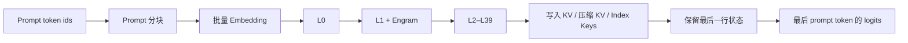
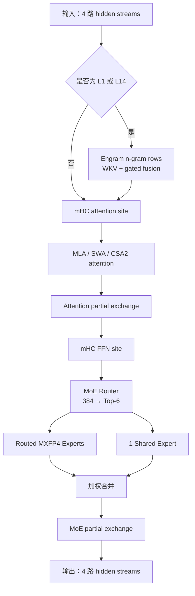
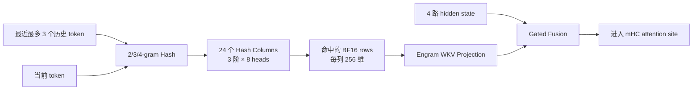
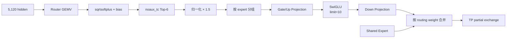
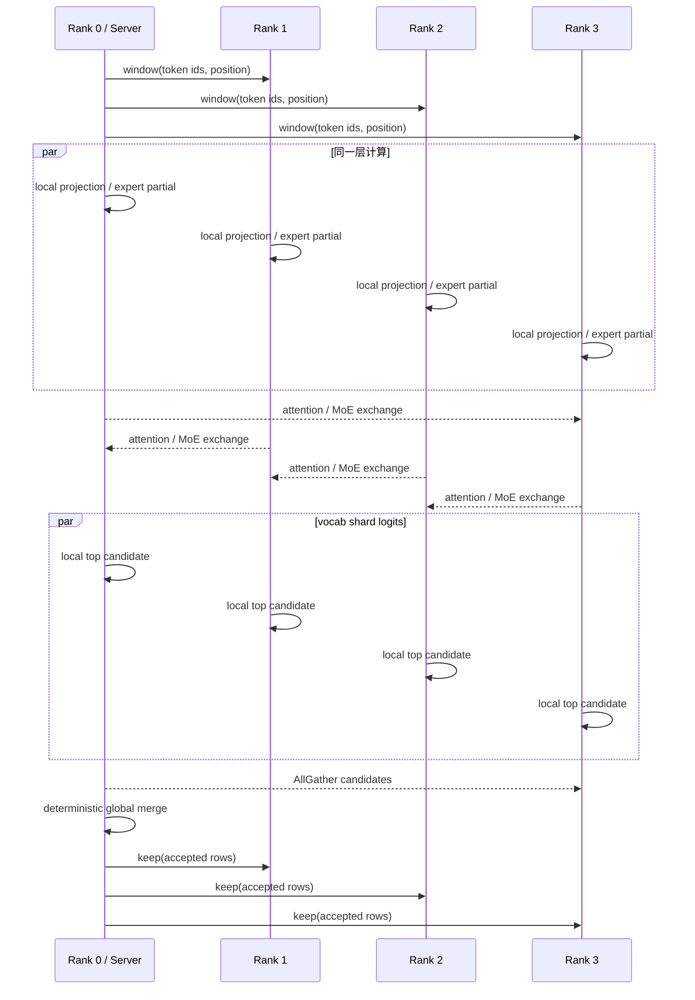
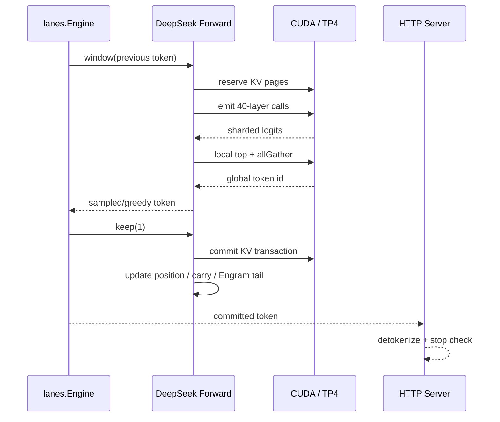

# DeepSeek-V4.1-Flash 在 TensorFold 中的一次文本推理架构

## 1. 文档范围

本文结合当前 TensorFold 代码、DeepSeek-V4.1-Flash-1017 配置以及本地 official mixed 在研路径，说明一次文本请求从 OpenAI 兼容接口进入 TensorFold，经过模板渲染、分词、prefill、40 层主干、TP4 集合通信、全局 token 选择，最后以 SSE 返回客户端的完整过程。

本文重点描述 CUDA 文本推理路径，并区分两种权重后端：

- `official_mixed`：官方 safetensors 的混合精度布局，dense 权重以 MXFP8/FP8 为主，routed experts 为 MXFP4，scale 使用 UE8M0；本地实验路径要求 TP=4、完整 40 层、单 slot、关闭 drafts。
- `exl3`：TensorFold 已有的 DeepSeek-V4.1 EXL3 路径，可连接 DSpark speculative decoding 和既有 x3ld expert kernels。

本文依据当前源码进行静态核验，不代表 official mixed 路径已经完成四 rank 全模型、真实 checkpoint 和生产环境验收。

## 2. 模型结构关键参数

DeepSeek-V4.1-Flash-1017 文本主干的关键参数如下。

| 项目 | 配置值 | 推理影响 |
| --- | ---: | --- |
| 词表大小 | 129,280 | LM head 和 logits 按 TP rank 切分 |
| hidden size | 5,120 | embedding、attention 输出、MoE 输出和 mHC 主状态宽度 |
| 主干层数 | 40 | 每个 prompt/decode 窗口依次经过 L0–L39 |
| attention heads | 64 | 每个 head 维度为 512 |
| Q LoRA rank | 1,280 | attention query 的低秩中间表示 |
| O LoRA rank | 1,024 | attention 输出投影的低秩结构 |
| RoPE head dim | 64 | 仅对 attention head 的部分维度施加旋转位置编码 |
| sliding window | 128 | L0–L1 使用短窗口注意力 |
| routed experts | 384 | 每层 MoE router 的候选专家数 |
| experts per token | 6 | 每个 token 选择 Top-6 routed experts |
| shared experts | 1 | routed experts 之外还有 shared expert |
| expert width | 2,304 | expert SwiGLU 中间宽度 |
| Engram layers | L1、L14 | 在 attention 之前注入 n-gram 记忆 |
| Engram max n-gram | 4 | 查询 2-gram、3-gram、4-gram 哈希列 |
| index Top-K | 512 | 压缩长上下文注意力每行选择的 KV 数量 |
| 最大上下文 | 1,048,576 | YaRN 从原生 65,536 扩展 16 倍 |
| DSpark target layers | L37、L38、L39 | EXL3 speculative path 的 next-token 目标层 |

参数直接来源于：

- `zig/src/families/deepseek_v41/fixtures/flash1017-config.json`
- `zig/src/families/deepseek_v41/config.zig`

## 3. 一次文本推理的总体架构

```mermaid
flowchart LR
    Client[客户端<br/>messages / tools / sampling] --> HTTP[OpenAI 兼容 HTTP 路由]
    HTTP --> Render[Chat Template 渲染]
    Render --> Tokenizer[Tokenizer<br/>文本转 token ids]
    Tokenizer --> Check[上下文、grammar、sampling 预检]
    Check --> Reply[engine_api.Reply]

    subgraph Control[TensorFold 控制面：CPU / Rank 0]
        Reply --> Host[LaneHost]
        Host --> Lanes[lanes.Engine]
        Lanes --> Schedule[请求槽位与 round 调度]
        Schedule --> Prefill[Prompt Prefill]
        Schedule --> Decode[Decode / Verify Window]
        Commit[Keep / Rollback 事务提交] --> Schedule
    end

    subgraph TP4[DeepSeek-V4.1 CUDA Target：TP=4]
        Prefill --> Embed[Embedding + 首次 TP 汇合]
        Decode --> Embed
        Embed --> Layers[40 层 DeepSeek 主干]
        Layers --> Final[Final mHC + Norm]
        Final --> Head[分片 LM Head<br/>每 rank FP32 logits]
        Head --> Pick[各 rank 局部候选]
        Pick --> Gather[AllGather + 全局确定性合并]
    end

    Gather --> Commit
    Commit --> Detok[Detokenize]
    Detok --> SSE[SSE 增量响应]
    SSE --> Client
```

架构边界的核心设计是：HTTP、模板和文本协议属于 server；请求生命周期、round、取消、commit/rollback 属于共享 lane core；DeepSeek family 只负责模型结构、权重、GPU 调用图和 family-specific 状态。

## 4. 请求进入 TensorFold

### 4.1 HTTP 与聊天模板

`/v1/chat/completions` 请求首先进入 server 层。`zig/src/server/chat.zig` 负责：

1. 读取 `messages`、`tools`、`temperature`、`top_p`、`top_k`、`stop` 和 `max_tokens`。
2. 使用 checkpoint 的 chat template 渲染完整 prompt。
3. 通过 tokenizer 把 prompt 编码为 token ids。
4. 计算历史长度、可复用前缀、最后用户消息边界和 prompt chunk starts。
5. 在模型执行前检查上下文窗口、回复余量、grammar、sampling 和模型能力。

渲染完成后，server 构造 `engine_api.Reply`。这个结构是 server 与 native engine 之间的稳定边界，包含：

- prompt token ids；
- EOS 与 stop token；
- sampling 配置；
- grammar/structured-output 状态；
- prompt chunk 计划；
- history、rewind、user-end 和 prefix-cache 提示；
- logprobs、thinking budget 和取消语义。

对应源码：

- `zig/src/server/chat.zig:123`
- `zig/src/core/engine_api.zig:67`

### 4.2 LaneHost 与共享 lane core

DeepSeek server 在 `zig/src/families/deepseek_v41/serve_engine.zig` 中构造：

- `model.Model`：CUDA context、权重、KV、通信器和 family forward；
- `lanes.Engine`：共享的请求生命周期和 round 调度；
- `api.LaneHost`：把 lane engine 固定运行在持有 CUDA context 的模型线程上；
- target adapter：执行 DeepSeek 主干窗口；
- optional draft pass：EXL3 路径可使用 DSpark；
- follower protocol：rank 0 将 window、keep、stop 等控制消息同步给其他 rank。

共享 lane core 负责并发请求、公平调度、取消、停止条件、draft verification 以及事务提交。DeepSeek family 不实现第二套并行 scheduler。

## 5. Prefill 路径

Prefill 的目标是把全部 prompt 转换为可以继续自回归生成的模型状态。

TensorFold 的 prefill 有以下代码特性：

- 使用 symbolic emitter 生成与实际行数、起始位置、layer set 对应的调用序列。
- AOT Triton specialization、CUDA extension kernel 和 CUDA graph 共同执行调用序列。
- 长 prompt 可按 `prefill_rows` 分段，避免一次生成过大的 workspace。
- KV、压缩 KV、index keys 和 Engram tail 必须在 prompt/decode seam 上保持一致。
- prefill 不只是计算最后 logits；它还建立后续 decode 所需的全部持久状态。

主要源码：

- `zig/src/families/deepseek_v41/forward.zig`
- `zig/src/families/deepseek_v41/block_prefill.zig`
- `zig/src/families/deepseek_v41/run.zig`

## 6. 单层 DeepSeek 主干结构

40 个主干层的通用计算顺序如下。

`zig/src/families/deepseek_v41/block.zig` 中的主干 emitter 顺序可概括为：

1. 第一个层前执行 embedding glue 和首次 rank exchange。
2. 若当前层是 Engram 层，在 attention mHC site 之前执行 Engram。
3. 执行 attention 前的 mHC mixing。
4. 执行当前层的 attention。
5. 交换 attention partial。
6. 执行 FFN 前的 mHC mixing。
7. 执行 routed/shared MoE。
8. 交换 MoE partial，进入下一层。
9. 最后一层结束后执行 final mHC 和 LM head。

### 6.1 mHC 多流状态

配置中的 `hc_mult=4` 对应四路 hidden state。mHC 在 attention、FFN 和 final norm 的边界执行 learned mixing，使层间状态不是简单的单一残差流。

TensorFold 将 mHC coefficient、pre/post mixing 和前一轮 TP exchange 组织为明确调用点，并允许部分 coefficient 工作在独立 CUDA side stream 上与主路径重叠。

主要源码：

- `zig/src/families/deepseek_v41/block_moe.zig:22`
- `zig/src/families/deepseek_v41/branches.zig`

## 7. 注意力拓扑

DeepSeek-V4.1-Flash 并不是 40 层都使用相同的全量 KV attention。TensorFold 根据 `Config.mode(layer)` 将层分为四种模式：

- `swa`：短滑动窗口；
- `full`：创建压缩 KV source 和 index source；
- `reindex`：复用已有 KV source，但生成新的 index selection；
- `reuse`：复用最近的 KV source 和 index source。

### 7.1 逐层分组

| 层范围 | 模式 | KV source | Index source | 压缩比 | 特殊节点 |
| --- | --- | --- | --- | ---: | --- |
| L0 | SWA | — | — | 0 | 128-token sliding window |
| L1 | SWA | — | — | 0 | Engram |
| L2 | Full source | L2 | L2 | 2 | 建立第一组压缩 KV/index |
| L3–L7 | Reuse | L2 | L2 | 2 | 复用 L2 selection family |
| L8 | Full source | L8 | L8 | 2 | 新 KV/index source |
| L9–L13 | Reuse | L8 | L8 | 2 | — |
| L14 | Full source | L14 | L14 | 2 | Engram + 新 KV/index source |
| L15–L19 | Reuse | L14 | L14 | 2 | — |
| L20 | Full source | L20 | L20 | 1 | candidate block source |
| L21–L23 | Reuse | L20 | L20 | 1 | — |
| L24 | Reindex | L20 | L24 | 1 | 对 L20 KV 重新选择 |
| L25–L27 | Reuse | L20 | L24 | 1 | — |
| L28 | Reindex | L20 | L28 | 1 | — |
| L29–L31 | Reuse | L20 | L28 | 1 | — |
| L32 | Reindex | L20 | L32 | 1 | — |
| L33–L35 | Reuse | L20 | L32 | 1 | — |
| L36 | Reindex | L20 | L36 | 1 | — |
| L37–L39 | Reuse | L20 | L36 | 1 | DSpark target layers |

### 7.2 稀疏长上下文选择

对压缩层，TensorFold 的 attention 路径分为：

1. Q projection：`wq_a → q_norm → wq_b`。
2. KV projection：生成 512 维 latent KV，并按层模式写入 SWA ring 或压缩 KV pool。
3. Index query/key：生成 index scores。
4. Top-K selection：每行选择 512 个位置。
5. Candidate block：L20 可以先选择 2,048 个、每块 8 token 的候选块。
6. Reindex：L24/L28/L32/L36 在候选或现有压缩 KV 上重新计算 selection。
7. TP exchange：需要时交换本 rank 负责的压缩 KV rows。
8. Attention kernel：在 SWA ring 和选中的压缩 KV 上完成注意力。

当 index score workspace 超过预算时，`block_index.zig` 会按 row blocks 计算 score/top-k，而不是一次物化整个 score 矩阵。

主要源码：

- `zig/src/families/deepseek_v41/block_attn.zig:183`
- `zig/src/families/deepseek_v41/block_index.zig:42`
- `zig/src/families/deepseek_v41/config.zig:258`

## 8. Engram 外部记忆

Engram 位于 L1 和 L14，在 attention 前注入基于最近 token n-gram 的外部记忆。

关键结构：

- `engram_max_ngram_size=4`，因此使用 2/3/4-gram。
- `engram_n_heads=8`，哈希列总数为 `(4-1) × 8 = 24`。
- 每个哈希列返回 256 维 row。
- 两张表分别约有 3.840 亿行。
- TensorFold 可以从 host/NVMe row source 读取命中项，不需要把整张 Engram 表都复制到 GPU。
- gate worker 可以提前读取一个窗口中各层需要的 rows，再由 `engram_rows` glue 将结果送入 GPU 图。

主要源码：

- `zig/src/families/deepseek_v41/block_moe.zig:304`
- `zig/src/families/deepseek_v41/forward_engram.zig`
- `zig/src/families/deepseek_v41/engram_rows.zig`

## 9. MoE 路径

每个主干层都包含 routed/shared MoE。

### 9.1 official mixed 路径

- routed expert weights 使用 MXFP4。
- dense/shared 相关矩阵按 checkpoint 实际格式读取，通常为 MXFP8/FP8 block weights 和 UE8M0 scale。
- `native_emit.zig` 发射 native mixed 和 native MoE kernels。
- 权重按 rank image 直接绑定，不先伪装成 EXL3，也不在启动时整体反量化。

### 9.2 EXL3 路径

- 使用 TensorFold 既有 EXL3 trellis、`suh/svh` forms 和 x3ld grouped kernels。
- 支持已有的 expert grouping、可选 side-stream 和 L2 prefetch 优化。
- 可连接 DSpark draft pass。

主要源码：

- `zig/src/families/deepseek_v41/block_moe.zig:136`
- `zig/src/families/deepseek_v41/native_emit.zig`
- `zig/kernels/cuda/deepseek_v41/`

## 10. TP4 执行与通信

official mixed 本地路径要求四个 rank。rank 0 同时承担 HTTP 服务和 lane 控制，其余 rank 运行 follower loop。

TensorFold 不在每一步都收集完整 logits。每个 rank 只计算自身 vocab 分片的 FP32 logits，然后：

1. 在本 rank 求局部 top candidate。
2. 通过 `allGather` 收集各 rank 候选。
3. 按确定性顺序合并为全局 token id。
4. rank 0 把 keep 数量同步给所有 follower。

主要源码：

- `zig/src/families/deepseek_v41/forward_glue.zig`
- `zig/src/families/deepseek_v41/forward_follow.zig`
- `zig/src/families/deepseek_v41/forward_sample.zig:20`

## 11. Decode、选择与事务提交

一次普通 greedy decode 的时序如下。

关键点是前向计算和状态提交分离：

- `Forward.window` 生成 logits，但只创建 pending transaction。
- lane core 根据 plain/draft verification 结果决定接受行数。
- `Forward.keep` 才真正推进 position、KV transaction、ratio-2 compressor carry、session state 和 Engram tail。
- 取消、拒绝或 partial acceptance 不应污染下一轮请求。

主要源码：

- `zig/src/families/deepseek_v41/forward.zig:263`
- `zig/src/families/deepseek_v41/forward.zig:313`
- `zig/src/core/lanes/`

## 12. DSpark speculative decoding 的位置

配置包含三个 next-token prediction layers，并把 L37、L38、L39 指定为 DSpark target layers。EXL3 路径中，DSpark 作为 lane draft pass 工作：

1. target forward 计算并保留指定层 taps。
2. DSpark 根据这些 taps 生成候选 token 序列或树。
3. 下一轮 target window 一次验证多个 draft rows。
4. lane core 只提交 target 接受的前缀。
5. 所有接受 token 必须与相同引擎的 `draft=false` 输出逐 token 一致。

当前本地 official mixed 路径为了先完成原生 checkpoint correctness，明确关闭 drafts，因此主执行图仍保留 DSpark 结构信息，但一次 official mixed 文本推理按普通单 token decode 运行。

主要源码：

- `zig/src/families/deepseek_v41/serve_engine.zig`
- `zig/src/families/deepseek_v41/draft/`
- `zig/src/families/deepseek_v41/dspark_gpu.zig`

## 13. 输出返回

全局 token id 提交后，server 负责：

1. 增量 detokenize。
2. 检查 EOS、stop strings、loop guard 和 `max_tokens`。
3. 根据 reasoning/tool grammar 划分文本、思考和工具调用片段。
4. 生成 OpenAI 兼容 SSE delta。
5. 在最终事件中输出 `finish_reason`、usage 和 TensorFold runtime 信息。

模型 family 不直接构造 HTTP JSON，因此同一 native engine 可以复用 server 的认证、限流、grammar、streaming 和错误处理能力。

## 14. TensorFold 针对该模型的核心代码特性

### 14.1 Symbolic planner 与实际执行解耦

`block.zig`、`block_attn.zig`、`block_index.zig` 和 `block_moe.zig` 生成结构化 `Call` 序列；`run.zig` 负责把这些调用绑定到 persistent buffers、scratch、AOT Triton functions 和 CUDA extension kernels。

这使 TensorFold 可以：

- 为不同 rows、position、layer set 生成精确调用图；
- 在运行前检查 AOT specialization 是否齐全；
- 对常见 decode window 捕获 CUDA graph；
- 让 prefill、decode、replay 和 follower 使用相同的算术定义。

### 14.2 Family 状态与共享引擎状态分层

- 共享 lane core：请求、round、draft verification、commit/rollback、取消。
- DeepSeek Forward：KV、index、Engram tail、layer carry 和 rank follower。
- Runner：设备地址、scratch、side streams、AOT/kernel dispatch。
- Server：HTTP、模板、tokenizer、grammar、SSE。

### 14.3 只在明确位置通信

TP partial 不会任意穿插在算子内部，而是在 embedding、attention、MoE 和 logits selection 的明确 glue 点进行。这便于：

- 保证 rank 间位置和窗口一致；
- 将通信与 independent projection/side-stream 工作重叠；
- 在 follower protocol 中重放相同操作顺序；
- 对每个通信边界进行独立测试。

### 14.4 混合权重后端保持同一模型语义

official mixed 和 EXL3 的权重加载、projection 和 expert kernels 不同，但共享：

- 40 层模型拓扑；
- mHC、attention、Engram、router 和输出语义；
- lane core 和 server contract；
- KV、index 和 TP 通信协议；
- plain token correctness oracle。

## 15. 当前验证边界

当前代码与本地工作记录可以支持以下结论：

- DeepSeek-V4.1 的配置、40 层结构、稀疏 attention、Engram、MoE 和 DSpark 接线可以从源码静态确认。
- official mixed 的 native projection/MoE 局部 CUDA fixtures 和 host-side 规划已有记录。
- production CUDA model、HTTP engine 和 follower CLI 已有显式 official native 接线。
- 当前可用单台 SM121 主机不能同时容纳约 117.492 GiB/rank 的原始权重切片和完整运行时状态。

尚不能据此宣称：

- official mixed 已通过四 rank、完整 40 层、真实 checkpoint 的 teacher-forced 输出对比；
- M4 whole-model correctness 已完成；
- M5 rank-local prepared store 已完成；
- M6 四台 GB10 NVMe residency 和服务稳定性已验收；
- 当前路径已达到生产支持状态。

## 16. 主要源码索引

| 主题 | 文件 |
| --- | --- |
| HTTP 请求与 prompt 构造 | `zig/src/server/chat.zig` |
| Engine API | `zig/src/core/engine_api.zig` |
| Lane core | `zig/src/core/lanes/` |
| DeepSeek server adapter | `zig/src/families/deepseek_v41/serve_engine.zig` |
| CUDA model 启动与权重绑定 | `zig/src/families/deepseek_v41/cuda_model.zig` |
| Forward 状态与窗口 | `zig/src/families/deepseek_v41/forward.zig` |
| 主干 symbolic emitter | `zig/src/families/deepseek_v41/block.zig` |
| Attention/KV | `zig/src/families/deepseek_v41/block_attn.zig` |
| Index/top-k | `zig/src/families/deepseek_v41/block_index.zig` |
| mHC/MoE/Engram/head | `zig/src/families/deepseek_v41/block_moe.zig` |
| Glue 与集合通信 | `zig/src/families/deepseek_v41/forward_glue.zig` |
| Greedy/global top-k | `zig/src/families/deepseek_v41/forward_sample.zig` |
| Follower protocol | `zig/src/families/deepseek_v41/forward_follow.zig` |
| GPU 调用执行器 | `zig/src/families/deepseek_v41/run.zig` |
| 模型配置 | `zig/src/families/deepseek_v41/config.zig` |
| 官方配置 fixture | `zig/src/families/deepseek_v41/fixtures/flash1017-config.json` |

