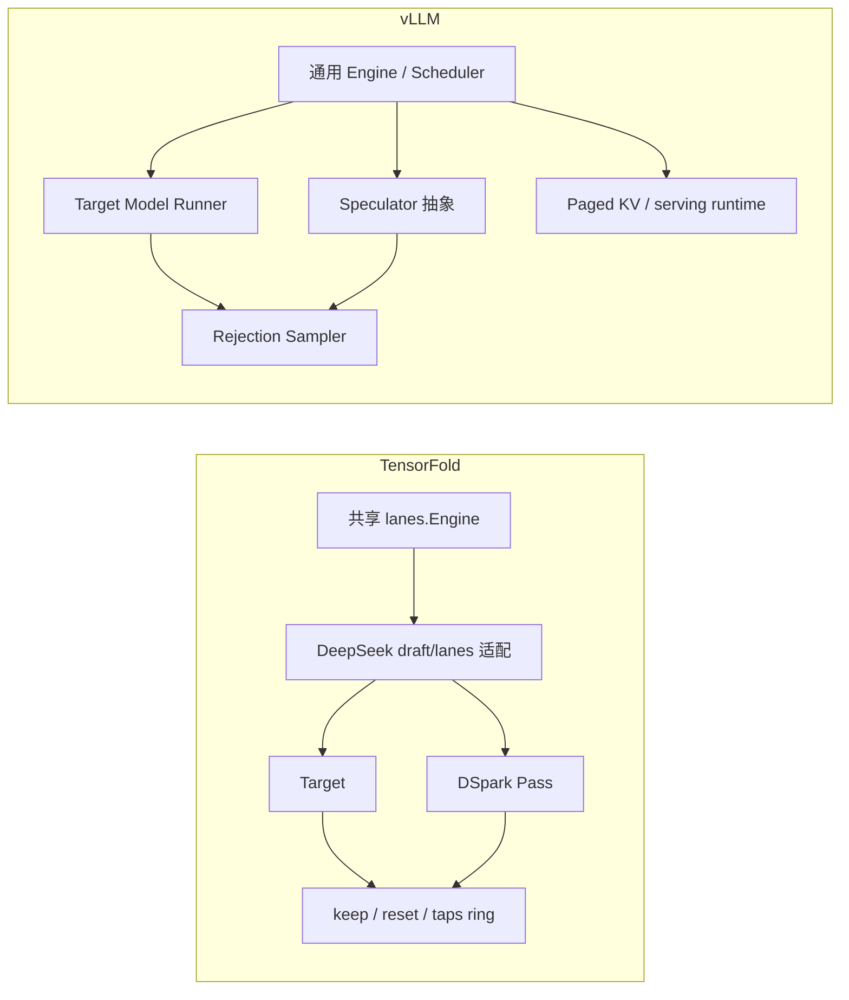

# TensorFold 投机解码特性及与 vLLM 的差异

> 对比基线：TensorFold 当前仓库的 DeepSeek V4.1/DSpark 实现，以及 2026-11-06 可见的 vLLM 主线官方文档与源码。vLLM 迭代很快，本文不沿用早期版本“仅支持 n-gram”或“只能固定草稿长度”的结论。

## 1. 核心结论

TensorFold 的投机解码特色不是算法种类更多，而是**把 DSpark 作为 DeepSeek V4.1 模型族的一等执行阶段，嵌入统一 lanes 状态机，并把缓存、采样、接受、回滚和并发 slot 生命周期放在同一套精确性契约下**。

vLLM 的强项则是**通用化、方法生态和大规模 serving 集成**：同一框架支持 draft model、EAGLE、MTP、DSpark、n-gram、suffix、DFlash/PARD 等方法，并提供标准 rejection sampling、概率草稿、异构词表和插件式 speculator。

两者当前都有 DSpark adaptive verification，因此不能简单概括为“TensorFold 动态、vLLM 固定”。更准确的判断是：

- TensorFold 更像一个针对 DeepSeek V4.1 精确执行路径深度定制的 speculative state machine。
- vLLM 更像一个将多种 proposer、verifier 和调度策略纳入通用 serving engine 的 speculative platform。

## 2. 总体架构差异



| 维度 | TensorFold 当前实现 | vLLM 当前主线 |
|---|---|---|
| 抽象中心 | lane/stream 的目标路径与事务状态 | 通用 speculator + target runner + rejection sampler |
| 主要优化对象 | DeepSeek V4.1 内建 DSpark | 多模型、多 proposer、多硬件 serving |
| 草稿来源 | 当前路径重点是 DSpark/MTP block，可扩展 lookup/tree | DSpark、EAGLE、MTP、draft model、n-gram、suffix、DFlash/PARD 等 |
| 接受语义 | 目标模型按同一 keyed sampling 产生路径，只提交连续匹配前缀 | 标准概率 rejection sampling、greedy/target-only、block、synthetic，以及显式有损 FLy |
| 状态回滚 | `Target.window` 临时推进，`keep(path)` 事务化保留唯一目标路径 | scheduler/model runner 管理 speculative token、KV slot 与 rejection sampler 输出 |
| 动态长度 | 成本表、近期接受率、confidence、跨 stream 联合分配 | DSpark adaptive verification：confidence、生存概率、全局预算与成本曲线 |
| 扩展方式 | 修改/实现 Zig family、Target/Pass 与 lanes 后端 | 内建方法或注册 custom speculator/plugin |
| 工程取向 | 小而专、模型族强约束、可审计状态机 | 大而全、广泛模型与部署生态、配置能力强 |

## 3. TensorFold 特有或更突出的处理特性

### 3.1 投机解码不建立第二套调度器

TensorFold 在项目贡献契约中明确要求：模型族只能增加算子和权重处理，不能在共享 engine 旁再建一个 scheduler。DeepSeek DSpark 通过 `draft/lanes.zig` 实现通用 backend，最终仍由 `zig/src/core/lanes/engine.zig` 负责请求生命周期、批处理、接受和提交。

这带来两个明显特征：

1. 普通解码、草稿解码、取消、恢复、grammar 和并发 stream 共享同一状态机。
2. DSpark 优化不能绕开 engine 的 token ownership 和 cache ownership。

vLLM 同样把 speculative decoding 集成在主 scheduler/model runner 中，但其抽象边界更偏向“可替换 speculator + rejection sampler”，而 TensorFold 的边界更偏向“目标路径事务 + family adapter”。

### 3.2 `window → acceptPath → keep(path)` 的事务化缓存语义

TensorFold 的一次验证先允许目标模型临时执行整个链或树，然后通过三步完成事务：

```text
Target.window([pending, drafts...])
        ↓
core/lanes/accept.acceptPath(...)
        ↓
Target.keep(chosen_target_path)
```

`keep(path)` 不只是删除几个未接受 token，而是模型族必须实现的状态提交边界。链式拒绝、树分支、KV、逻辑长度以及可能的递归/辅助状态都在这一边界重新对齐。

这种接口对 DeepSeek V4.1 很重要，因为框架不把模型状态简化成“只有标准 Transformer KV”。相较之下，vLLM 的优势是成熟的 paged KV 和通用调度集成；TensorFold 的优势是 family 可以通过统一 `keep` 契约表达目标模型特有状态，而不把所有状态强行投射为通用 KV block 操作。

### 3.3 强制要求 drafted 与 plain token-by-token 等价

TensorFold 项目级规范要求：同一 checkpoint、backend、runtime 和设置下，drafted 输出必须与 `draft:false` 输出逐 token 相同；恢复路径、并发请求、取消/reset 后的下一请求也必须满足一致性。

这比“理论上保持目标分布”更偏工程确定性。TensorFold 的 DSpark 链比较的是目标模型在 keyed sampling 位置得到的实际选择，提交的始终是目标路径。

vLLM 的标准 rejection sampler同样以 lossless/distribution-preserving 为目标，但官方文档明确区分：

- 标准 rejection sampling 在算法上保持目标分布；
- probabilistic draft sampling 可保留完整 draft distribution 做概率比接受；
- floating-point、批大小和 logprob 数值稳定性可能造成不同运行间输出差异；
- FLy verifier 是显式的有损选项。

所以两者的“正确”定义略有不同：TensorFold 当前契约强调**同引擎 plain/drafted 的可复现 token 等价**；vLLM 的通用标准更强调**采样分布无损**，同时允许用户显式选择非严格验证方法。

### 3.4 DSpark 上下文是独立、已提交的 taps ring

TensorFold 为每个 slot 保留最多 128 行、只包含已提交目标隐藏状态的 DSpark ring。Prompt prefill、resume、reset 和 slot reuse 都必须显式维护它。

这一设计有三个效果：

- 被拒绝的验证行不会污染下一轮 drafter 上下文；
- DSpark 的上下文身份与目标 KV 身份可以分别验证；
- 多 slot 支持必须显式开启并保证 ring 隔离，不能隐式复用单 slot pass。

vLLM 的 `TargetDependentARSpeculator` 同样支持依赖目标隐藏状态的 EAGLE/MTP/DSpark 类方法，但它位于更通用的 speculator/model-runner 体系中；TensorFold 则把 taps 的 ingest、窗口裁剪和 slot 生命周期直接做成 DeepSeek family contract。

### 3.5 “先完整 draft，再按经济性裁剪 verify”的联合深度策略

TensorFold 的 `core/lanes/depth.zig` 不是只看某个请求的 confidence threshold，而是把以下信息放到共同收益模型：

- verify 不同行数的校准成本；
- DSpark pass 和额外 slot 成本；
- 最近轮次的实际接受率；
- DSpark confidence 转成的连续前缀存活概率；
- 当前 batch rows；
- 多 stream 的联合预算与公平性；
- plain decode guard、probe 和 held draft 的继续价值。

其选择目标接近“单位毫秒的期望 token 数”，并允许深度为 0，即高负载或低收益时退回普通解码。

这是 TensorFold 很鲜明的设计，但不再是相对 vLLM 的独占能力。vLLM 当前 DSpark adaptive verification 也把每个位置 confidence 连乘为 survival probability，在请求间选择全局最佳 draft slots，并用启动时 profile 的 step-cost table 选择预算。vLLM 官方说明还包括 CPU/GPU 双缓冲预算、GPU 当前 confidence 分配和 variable-length verification。

差别主要在策略落点：

- TensorFold 的规则属于通用 lanes depth allocator，可同时考虑 family costs、shared costs、held 状态和公平性。
- vLLM 的 adaptive verification 属于通用 serving scheduler/model runner 的 DSpark 验证压缩路径，面向高并发下的全局 token budget。

### 3.6 提前启动下一轮 DSpark，而不是仅做本轮 draft/verify

`draft/spec.zig` 支持在当前目标窗口得到 bonus token 后立即 `begin` 下一轮 DSpark pass，让 GPU 草稿与当前轮 host commit/control 重叠。结果只有在 slot、generation、提交路径、anchor、position 和 sampling 参数全部匹配时才复用。

这个机制值得与普通 speculative decoding 区分：普通流程是在下一轮正式开始后才执行 drafter；TensorFold 会对“下一轮输入仍然成立”做一次受控押注，并用严格身份检查避免陈旧结果污染请求。

vLLM 当前也在推进/支持 draft-model async scheduling 和 DFlash async scheduling，因此“异步 drafter”同样不是 TensorFold 永久独占。TensorFold 的特别之处是它被表达为 `Pass.begin/collect/arm` 与 lane generation/path 校验，且与 TP collective 顺序直接绑定。

### 3.7 链式、树式、lookup 可以进入同一目标路径接口

TensorFold 标准 DSpark 是链式 block，但可从首位置候选构造 sibling chains，通过 `parents` 交给同一 `acceptPath`；lookup/graft 也由 lanes 规划层组合。目标模型最终仍返回唯一可提交路径。

这种设计让“候选拓扑”与“提交语义”分离：chain、tree 或 graft 改变验证窗口，却不改变请求如何 commit/rollback。

vLLM 支持的方法更多，部分方法本身也会生成树或并行草稿；其通用性更强。TensorFold 的优势在于所有拓扑最终压缩为相同的 path transaction，代码审计路径较短。

### 3.8 Tensor Parallel collective 被纳入 Pass 生命周期

TensorFold DSpark 在各 rank 生成局部候选，gather 后执行 Markov chain；`Pass.arm`、`begin` 和 `collect` 明确约束 leader/follower 的 collective 顺序。提前 speculation 不能让 leader 单边越过 follower。

这是面向 DeepSeek V4.1 TP 执行的直接设计。vLLM 提供更完整的 TP/DP/EP 组合与独立 draft tensor-parallel 配置，部署弹性更强；但这也意味着兼容矩阵更复杂，例如 pipeline parallelism 与部分 speculative/adaptive verification 组合仍有限制。

### 3.9 启动时拒绝不满足精确契约的后端组合

TensorFold 当前 `native official + drafts` 直接返回 `NativeOfficialDraftsDisabled`；多 slot 没有正确 pass 时也拒绝或限制，而不是静默退化到可能错误的状态共享。

这是保守但容易审计的策略。vLLM 对硬件、attention backend、CUDA graph、LoRA、PP、输出 logprobs 等组合也设置 capability checks，不过其支持矩阵更宽、更动态，常通过配置验证决定启用、拒绝或切换执行路径。

## 4. vLLM 相比 TensorFold 更强的部分

### 4.1 Speculator 方法生态明显更广

vLLM 官方主线支持或公开描述了 EAGLE、MTP、独立 draft model、PARD、DSpark、DFlash、n-gram、suffix，以及实验性的 custom speculator。TensorFold 当前代码的高成熟路径集中在 DeepSeek V4.1 DSpark，其他能力更多是同一 lanes 内的 lookup/tree/graft 组合，而不是一个跨模型 proposer 市场。

### 4.2 接受算法更通用

vLLM 提供：

- 标准概率 rejection sampling；
- greedy draft 与 probabilistic draft；
- block verification；
- synthetic verifier；
- 显式有损的 FLy verifier。

TensorFold 当前 DSpark 更强调目标实际选择与草稿 token 的连续前缀匹配，没有暴露同等广泛的 rejection sampler 策略面。

### 4.3 独立 draft model 与异构词表

vLLM 可以给 target 配置独立 draft model、独立 draft TP size，并通过 Token-Level Intersection 支持不同 tokenizer/vocabulary 的草稿模型。TensorFold 当前 DSpark 是模型族内建权重、固定目标 taps 和同一 token 空间，不以跨模型异构词表为目标。

### 4.4 Serving 与硬件生态

vLLM 的 PagedAttention、连续批处理、prefix caching、DP/TP/EP、广泛量化和多硬件后端，使 speculative decoding 能进入更大的生产部署矩阵。TensorFold 的路径更窄，当前文档所述 DSpark 还明确不适用于 native official mixed 路径。

### 4.5 插件和训练闭环

vLLM V2 允许注册 custom speculator，`vllm-project/speculators` 还提供训练、数据生成、模型格式和部署闭环。TensorFold 的扩展目前更接近源码级 family/backend 开发，不是面向外部 Python 插件的公共生态。

## 5. 不能成立的旧式对比

以下说法对当前 vLLM 已不准确：

| 旧说法 | 当前事实 |
|---|---|
| “vLLM 只有固定 K” | vLLM 已有 DSpark adaptive verification 和动态全局预算 |
| “vLLM 不支持 DSpark” | 主线支持 `method: dspark`，DeepSeek V4.1 recipe 将其作为该 checkpoint 的 speculative 方法 |
| “vLLM 只支持 n-gram” | 这是早期 V1 阶段的历史状态，当前支持多种模型与非模型 proposer |
| “TensorFold 才能保证无损” | vLLM 标准 rejection sampler 也以 lossless 为目标；差别在精确性契约与可复现边界 |
| “vLLM 没有异步 drafting” | 当前 vLLM 已包含/推进多种 async scheduling 路径 |
| “动态裁剪是 TensorFold 独有算法” | 两者都依据 confidence、存活概率和成本选择验证预算，具体状态机与实现边界不同 |

## 6. 适用场景判断

### 更适合 TensorFold 的场景

- 目标就是 DeepSeek V4.1 + 内建 DSpark，愿意接受较窄的后端支持面。
- 需要审计 plain/drafted 逐 token 等价、resume、cancel、slot reuse 和并发隔离。
- 希望 family-specific 状态通过显式 `window/keep/reset` 管理。
- 需要直接控制 Markov head、taps ring、TP candidate gather 和下一轮 pass overlap。
- 团队更重视小型 Zig 执行栈和可追踪的状态所有权，而非 Python 插件生态。

### 更适合 vLLM 的场景

- 同一平台要服务多模型族和多种 speculation 方法。
- 需要 Paged KV、成熟 continuous batching、广泛量化和 DP/TP/EP 部署组合。
- 希望快速切换 EAGLE、MTP、draft model、n-gram、suffix 或 DSpark。
- 需要 probabilistic rejection sampling、异构词表或独立 draft model。
- 希望使用 Speculators 训练/格式/部署生态与插件扩展能力。

## 7. 最终评价

TensorFold 的独特价值不在于“有 DSpark，而 vLLM 没有”，也不在于“有动态验证，而 vLLM 只有固定长度”。当前真正有区分度的是：

1. **状态机中心不同**：TensorFold 以目标路径事务和 lane 生命周期为中心；vLLM 以通用 scheduler/model runner/speculator 为中心。
2. **正确性契约不同**：TensorFold 明确追求同引擎 plain/drafted token-by-token 等价；vLLM 以通用概率无损 rejection sampling 为主，并提供更多可选验证策略。
3. **专用程度不同**：TensorFold 深度绑定 DeepSeek V4.1 DSpark 的 taps、Markov、TP 和 cache 状态；vLLM 把 DSpark 放入跨模型通用框架。
4. **优化组合不同**：TensorFold 将动态深度、held drafts、tree/graft、下一轮 pass speculation 和事务回滚组合在同一 lanes 规则中；vLLM 的优势是大规模全局预算、成熟 serving 调度和广泛硬件/方法覆盖。
5. **工程取舍不同**：TensorFold 用更窄的支持面换取状态可审计性和模型族深度优化；vLLM 用更复杂的兼容矩阵换取生态、吞吐调度和部署普适性。

若只比较 DeepSeek V4.1 DSpark 的核心算法，两者正在趋同；若比较框架哲学，TensorFold 是“精确模型族执行器”，vLLM 是“通用高吞吐推理平台”。

## 8. 证据入口

TensorFold 源码：

- `zig/src/core/lanes/engine.zig`：共享轮次、接受、提交与回滚。
- `zig/src/core/lanes/depth.zig`：期望 token/成本、联合深度与公平性。
- `zig/src/families/deepseek_v41/draft/lanes.zig`：DeepSeek Target/Pass 适配。
- `zig/src/families/deepseek_v41/draft/dspark.zig`：Markov 与 confidence。
- `zig/src/families/deepseek_v41/draft/spec.zig`：下一轮 pass 提前执行和失效检查。
- `zig/src/families/deepseek_v41/draft/iface.zig`：`Target`、`Pass`、`keep`、`begin/collect/arm` 契约。
- `zig/src/families/deepseek_v41/serve_engine.zig`：成本校准、服务装配与 native official 限制。

vLLM 官方资料：

- [vLLM Speculative Decoding](https://github.com/vllm-project/vllm/blob/main/docs/features/speculative_decoding/README.md)
- [vLLM SpeculativeConfig](https://github.com/vllm-project/vllm/blob/main/vllm/config/speculative.py)
- [vLLM Rejection Sampler](https://github.com/vllm-project/vllm/blob/main/vllm/v1/sample/rejection_sampler.py)
- [vLLM DSpark Adaptive Verification](https://github.com/vllm-project/vllm-project.github.io/blob/main/_posts/2026-08-14-dspark-adaptive-verification.md)
- [vLLM Adaptive Verification API](https://docs.vllm.ai/en/latest/api/vllm/v1/worker/gpu/spec_decode/adaptive_verification/)
- [DeepSeek V4.1 vLLM Recipe](https://github.com/vllm-project/recipes/blob/main/models/deepseek-ai/DeepSeek-V4.1-Flash.yaml)
- [vLLM Speculators](https://github.com/vllm-project/speculators)

## 9. 验证边界

本文是静态源码与官方资料对比，不代表在同一硬件上完成了 TensorFold 与 vLLM 的性能实测。吞吐、TPOT、接受率和显存差异仍需在相同 checkpoint、GPU、并发、采样参数、上下文长度和输出长度下做交替基准测试后才能下结论。
