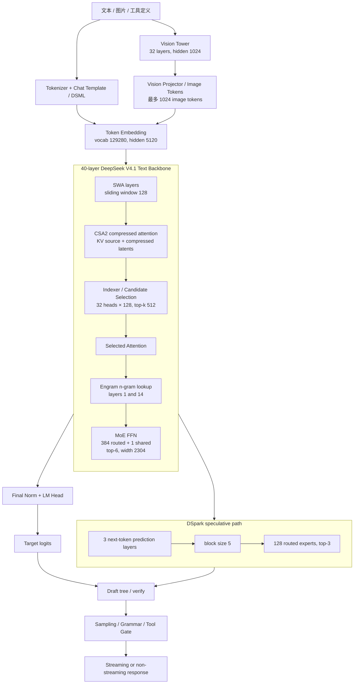
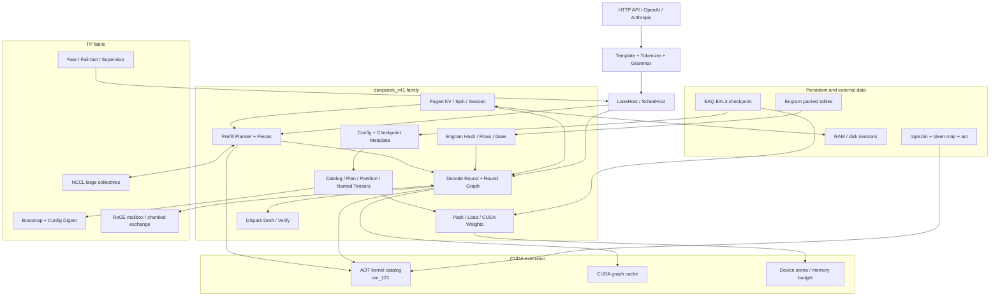
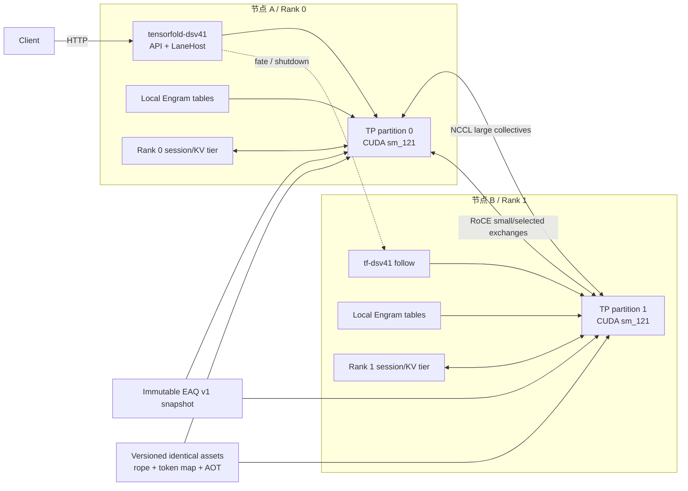
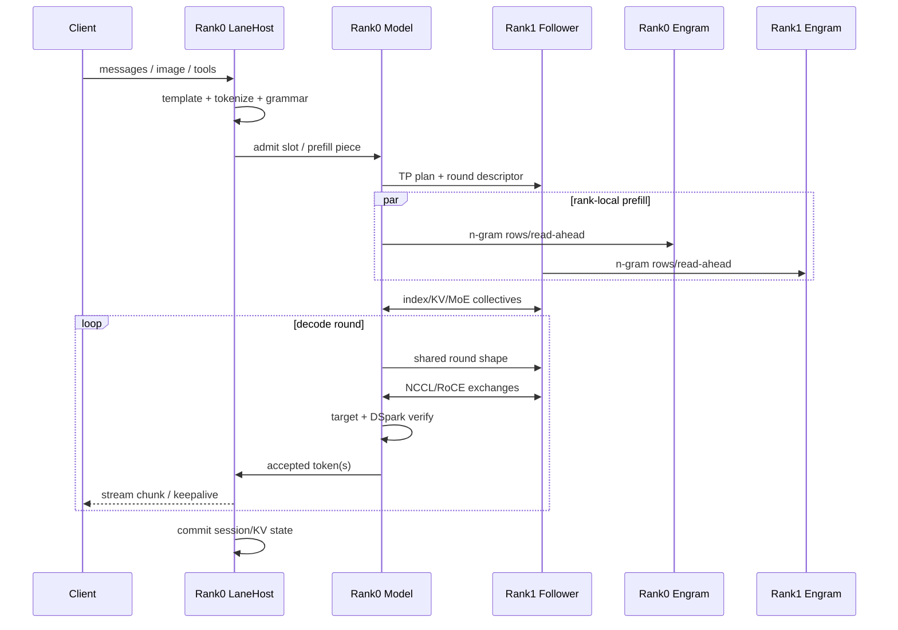
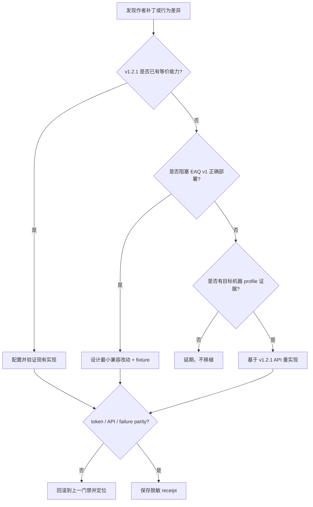

# DeepSeek V4.1 Flash 1017 × TensorFold v1.2.1 双机 GB10 详细架构设计

## 1. 文档定位

本文给出以下三者之间的详细设计关系：

1. DeepSeek V4.1 Flash 1017 模型架构。
2. TensorFold v1.2.1 推理框架及其 DeepSeek V4.1 CUDA family。
3. 作者双 GB10 方案使用的 TensorFold fork 和自定义补丁。

配套文档：

- [逐项改动追踪矩阵](deepseek-v41-flash-1017-v121-change-traceability.md)
- [34+2 补丁代码路径审计](deepseek-v41-flash-1017-v121-code-path-audit.md)
- [实施步骤与验收门禁](deepseek-v41-flash-1017-two-gb10-v121.md)

本文基于源码静态分析；尚未把“源码存在”描述为 GB10 运行验收通过。

## 2. 设计目标和约束

### 2.1 设计目标

- 在两台 GB10 上以 TP=2 服务作者推荐的 EAQ v1 2.9 bpw checkpoint。
- 首先达到 token 正确性和双 rank 可靠性，再追求作者方案的性能水平。
- 最大化复用 v1.2.1 已有能力，只移植有运行证据证明缺失的能力。
- 保持模型、资产、二进制、通信配置和运行 receipt 可追溯。

原因：作者补丁基于较早的 fork；v1.2.1 已重新实现多个相同目标。整套移植会形成重复状态机，并破坏 v1.2.1 已有的测试契约。

### 2.2 约束

- 基线 commit：`1db3edbe7e692e83c7f5056754dc4e69e79a6c22`。
- 首轮只支持 EAQ v1，EAQ v1.1 混合 BF16 独立立项。
- 使用专用 `tensorfold-dsv41` / `tf-dsv41`，不解除标准发布二进制门禁。
- GB10 AOT 目标固定为 `sm_121`。
- 两节点使用相同 checkpoint revision、资产 manifest 和 binary SHA256。

原因：同时扩大模型格式、服务入口和硬件目标会让问题无法归因。

## 3. DeepSeek V4.1 Flash 1017 模型架构

### 3.1 模型拓扑图

### 3.2 关键模型节点及推理含义

| 模型节点 | 结构 | 推理影响 | 设计原因 |
| --- | --- | --- | --- |
| M1 Token/DSML | tokenizer、chat template、特殊控制 token | tool choice、thinking、请求文本安全 | 用户文本若误匹配控制 token，会改变提示语义，因此 API 层和 tokenizer 层必须共同校验 |
| M2 Vision | 32 层视觉塔、patch 14、最多 1024 image tokens | 额外 tensor、AOT shape、缓存图片 digest | 文本启动成功不能证明多模态 checkpoint 完整 |
| M3 Backbone | 40 层、hidden 5120 | 主权重、主计算图 | 是 EXL3 量化、TP 切分和 CUDA graph 的主要承载节点 |
| M4 SWA | window 128 | 局部 KV、短窗口 attention | 与 compressed attention 的存储和调度不同，不能使用同一 KV 假设 |
| M5 CSA2/KV source | 压缩比例、KV source 层 2/8/14/20 | compressed latent、paged/split KV | 长上下文主要内存和跨 rank 数据面 |
| M6 Indexer | index source 2/8/14/20/24/28/32/36，top-k 512 | 长上下文候选筛选、排序、all-gather | 131K 以上可能成为主要瓶颈，是作者 indexer split 的模型落点 |
| M7 Candidate hierarchy | source layer 20、2048 blocks、block size 8 | 两级候选缩小 | 决定 prefill/index AOT shape 和 scratch budget |
| M8 MoE | 384 routed + 1 shared，token top-6 | expert 路由、跨 rank expert 计算 | 大部分参数和 kernel 变体集中于此；row shape 影响 GEMM 与确定性 |
| M9 Engram | 层 1/14、两个约 3.84 亿行表、最大 4-gram | 大型外部表、随机小读、read-ahead | 必须本地化热数据并处理跨 rank 失败，否则一边读失败会让另一边卡在 collective |
| M10 RoPE/YaRN | 1M context、factor 16、原始 64K | 长上下文位置编码资产 | `rope.bin` 必须覆盖 context + 2048，不能复用短上下文资产 |
| M11 DSpark | 3 个 next-n 层、block 5 | speculative draft/verify | draft 应只改变执行效率，不改变最终接受 token |
| M12 LM head/sampling | vocab 129280 | logits、grammar、工具门控 | tool required/named 的约束最终落在 token 生成入口 |

## 4. TensorFold v1.2.1 推理架构

### 4.1 框架分层图

### 4.2 TensorFold 特性节点

| 框架节点 | v1.2.1 特性 | 模型关联 | 设计原因 |
| --- | --- | --- | --- |
| T1 API/Template | OpenAI/Anthropic、tool choice、grammar | M1、M12 | 模型控制 token 与 API 语义必须一致 |
| T2 Metadata admission | 严格 config/quantization/refusal | M2–M11 | 错误几何进入 kernel 会造成静默错误或越界，因此 fail closed |
| T3 Planner/Partition | catalog、plan、TP partition、named tensor | M3–M9、M11 | 把 checkpoint 物理布局映射为每 rank 计算图 |
| T4 EXL3 loader | pack、dsq storage、CUDA format | M3、M6、M8、M11 | EAQ v1 兼容性的首要落点 |
| T5 AOT contract | `aot-needs`、kernel catalog、shape replay | M2–M11 | GB10 上不允许运行到一半才发现缺 specialization |
| T6 LaneHost/SchedHost | lanes、prefill pieces、并发 admission | M3–M12 | 决定长 prompt 与在线 decode 的公平性 |
| T7 KV subsystem | paged pool、split、compact、dedup、history | M4、M5、M6 | 1M context 的主要内存与跨 rank 数据结构 |
| T8 Session tier | RAM/disk park/restore | M4、M5、M2 | 长会话恢复和容量治理 |
| T9 Engram subsystem | token map、packed tables、AIO/read-ahead、gate | M9 | 外部超大表不适合当普通权重整体驻留 |
| T10 Draft subsystem | DSpark lanes、tree、cost calibration | M11、M12 | speculative decoding 的接受和确定性控制 |
| T11 Graph subsystem | round graph、graph cache | M3–M11 | 降低 decode launch gap，但必须限制长期内存 |
| T12 TP fabric | NCCL、mailbox、RoCE、plan link | M5、M6、M8、M9 | 两台 GB10 的数据交换平面 |
| T13 Fate/supervision | config digest、fail-fast、stall exit | 全模型 | 任一 rank 错误后不能留下半活服务 |
| T14 Memory accounting | boot budget、device arena、session budgets | M3、M5、M8、M9 | 每 rank 近百 GiB 权重下必须控制加载峰值和准备 scratch |
| T15 Metrics/receipts | health、metrics、token trace | 全模型 | 优化必须证明 token parity、实际 transport 和内存状态 |

## 5. 双机 GB10 部署架构

设计选择及原因：

- rank 0 承担 API，rank 1 只 follow：符合 v1.2.1 专用二进制职责，减少双写 API 状态。
- checkpoint 可以来自共享不可变 snapshot，但 Engram 高频随机读应在两节点本地：共享存储适合顺序加载，不适合每轮大量 4 KiB 随机读。
- assets 必须两节点 checksum 一致：AOT shape 或 token map 不一致会产生 rank 间数值和调用序列差异。
- NCCL 先建立正确性基线，再启用 RoCE：RoCE 是性能层，不能成为 loader/模型正确性首个变量。
- 最终 RoCE 验收使用 `TF_TP_ROCE_FALLBACK=error`：防止静默回退使性能结论无效。

## 6. 请求执行时序

原因分析：

- round shape 必须两 rank 一致，否则 graph、AOT 和 collective 调用序列会分叉。
- Engram 失败必须传播为 pair fault；仅一边失败会让另一边永远等待 collective。
- draft verify 在 target 路径内完成，客户端只看到接受 token，因此 draft on/off 可以做 token parity。
- 长 prefill 需要 pieces/keepalive，分别解决 GPU 调度阻塞和 HTTP 空闲超时，不能混为同一问题。

## 7. 详细模块设计

### 7.1 Checkpoint admission 与 EAQ v1 loader

设计：

1. 先用 host-side dry-open 解析 `config.json`、safetensors index、所有 tensor name/dtype/shape。
2. 使用严格的 `deepseek_v41` 几何校验：40 backbone layers、3 DSpark layers、384 experts、指定 CSA2 sources、Engram layers 和 YaRN 1M。
3. 校验 `quant_method=exl3` 及 dsq-1 需要的 codebook/out-scales。
4. 生成每 rank tensor plan 和字节统计，再进入 GPU 分配。
5. 只在真实 EAQ v1 差异出现时修改 `checkpoint_metadata.zig`、`cuda_format.zig`、`named.zig`、`plan.zig` 或 `load.zig`。

模型节点：M2–M11，重点 M3、M6、M8、M11。

框架特性：T2、T3、T4、T14。

原因：完整模型加载成本很高；metadata 阶段可以把格式错误与 CUDA、内存和通信错误分离。严格 admission 还能防止相似但不兼容的 checkpoint 被错误接受。

### 7.2 Asset pipeline

设计：

- `tf-dsv41-token-map` 生成 `engram-token-map.bin` 和 provenance。
- `aot-needs` 使用最终 TP/world/context/slots/draft/vision 形状生成 `needs.json`。
- 外部 reference tools 为 `sm_121` 编译 `aot/`。
- RoPE generator 生成覆盖 context + 2048 的 `rope.bin`。
- manifest 保存输入 SHA256、工具 revision、编译器版本和产物 SHA256。

模型节点：M2、M5–M11。

框架特性：T5、T9、T15。

原因：作者旧 kernel kit 与 v1.2.1 的 kernel contract 不具备天然 ABI 兼容性；重新生成比运行时猜测或 fallback 更安全。

### 7.3 TP partition 与通信

设计：

- world 固定为 2，两个 rank 的 config digest 必须一致。
- NCCL 承担默认和大 collective；RoCE 承担适合 mailbox/chunked 的交换。
- `TF_TP_ROCE_HCA` 显式绑定生产 HCA/GID；首次验证允许 NCCL fallback，正式验收禁止 fallback。
- plan link、fate channel 和 data transport 分别监控。

模型节点：M5、M6、M8、M9。

框架特性：T3、T12、T13。

原因：CSA2 index/KV 与 MoE 产生不同尺寸的交换，单一 transport 策略未必最优；但任何混合策略都必须保持两 rank 调用顺序一致。

### 7.4 KV、session 与长上下文

设计：

- 先使用默认 contiguous/paged KV 验证，再启用 `TF_DSV41_KV_SPLIT`。
- split 模式按逻辑 page 分配 compressed rows，必要时启用 compact/dedup/history/early。
- session 分 RAM resident、bounded staging 和 per-rank disk tier。
- restore 前校验两 rank identity、slot ownership 和模型/资产 fingerprint。

模型节点：M4、M5、M6、M10，以及图片会话的 M2。

框架特性：T7、T8、T12、T14。

原因：1M context 的主要可变内存是 KV/session，而非只看静态权重；恢复错误的旧 KV 比拒绝恢复更危险，因此不一致必须 fail closed。

### 7.5 Engram I/O

设计：

- token map 与 packed table 分离；token map 属于版本化 assets，超大 tables 属于每节点本地数据。
- Linux 使用异步读/read-ahead；每次 prompt 切换或取消清理上一个 read batch。
- table 大小、row range、hash geometry 和 fingerprint 启动时验证。
- 任一 rank 的 read failure 进入统一 pair fault。

模型节点：M9。

框架特性：T9、T13、T14。

原因：Engram 在层 1 和 14 参与主路径；错误行不是可忽略的 cache miss，而会直接改变隐藏状态。

### 7.6 Prefill 与在线调度

设计：

- 基线整 prompt prefill，正确后开启 `TF_DSV41_PREFILL_PIECES=1`。
- pieces 模式要求 own-prefill 和 verify tail 的 served shape。
- index scratch 受 `TF_DSV41_INDEX_BUDGET_MIB` 限制。
- 只有现有 pieces 仍无法满足延迟目标时，才设计额外 interleave。

模型节点：M3–M10，重点 M6。

框架特性：T5、T6、T7、T14。

原因：长 prompt 的 indexer 和 attention 占用时间长；分片解决调度公平性，但过度切片会增加同步和 kernel launch 成本。

### 7.7 Decode、DSpark 与 graphs

设计：

- draft off 建立 target golden，再开启 DSpark。
- draft 接受 token 与 target 复核；固定 seed 下比较最终 token ids。
- round graph 根据真实 shape 捕获；监控 graph count、host/device bytes 和 eviction。
- graph cap 只有在长期增长证据出现时才开发，并基于 v1.2.1 graph cache API 实现。

模型节点：M3–M12，重点 M11、M12。

框架特性：T10、T11、T15。

原因：draft 和 graph 都是性能层，不得改变模型语义；先有 golden 才能判断优化是否安全。

### 7.8 API、工具调用和请求安全

设计：

- 使用 v1.2.1 现有 required/named tool choice 能力，先运行 DSML fixture。
- 验证工具前 prose、stream/non-stream 内容一致。
- 用户普通文本不得被识别为 DSML、role 或 think 控制 token。
- Anthropic 宽容行为和 stream keepalive 作为 API compatibility feature，独立于模型 kernel 移植。

模型节点：M1、M12。

框架特性：T1、T6、T15。

原因：这些改动不改变权重计算，但会改变 prompt token 序列或响应字段；必须以 API receipt 和 token trace 验证。

### 7.9 内存治理与故障模型

设计：

- 启动前预算静态权重、AOT、RoPE、KV、session、graph 和 prepare scratch。
- 记录加载峰值而非只记录稳态。
- prepare 阶段在内存低于安全线时延迟 admission。
- rank link、round progress、Engram I/O、session restore 均连接到统一 fate/supervisor。

模型节点：全模型，重点 M5、M8、M9、M10。

框架特性：T13、T14、T15。

原因：GB10 统一内存不足时可能导致整机冻结，而不是普通 device OOM；故障策略必须优先保护双节点可恢复性。

## 8. 改动决策框架

原因：作者补丁说明“旧 fork 存在问题”，不自动证明 v1.2.1 存在同一问题；必须先检查等价能力和运行证据。

## 9. 设计完成标准

- 模型 M1–M12 均有对应 runtime 责任域和验收项。
- 框架 T1–T15 均有明确配置、失败策略和 receipt。
- 每个作者改动均在追踪矩阵中映射模型节点、框架节点和 v1.2.1 决策。
- loader/asset/TP/NCCL 基线通过前，不接受性能补丁。
- 所有实装改动都具有 host test 或 GPU receipt，且能独立回滚。

## 10. 源码证据入口

- `zig/src/families/deepseek_v41/config.zig`
- `zig/src/families/deepseek_v41/checkpoint_metadata.zig`
- `zig/src/families/deepseek_v41/plan.zig`
- `zig/src/families/deepseek_v41/load.zig`
- `zig/src/families/deepseek_v41/serve_engine.zig`
- `zig/src/families/deepseek_v41/kv/`
- `zig/src/families/deepseek_v41/draft/`
- `zig/src/families/deepseek_v41/engram_*.zig`
- `zig/src/fabric/tp/`
- `docs/recipes/deepseek-v41-cuda.md`

