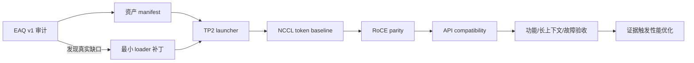

# DeepSeek V4.1 Flash 1017 作者改动与 TensorFold v1.2.1 追踪矩阵

## 1. 使用说明

本表把作者部署仓库的 TensorFold patch、自定义输入工具和运维代码映射到：

- DeepSeek 模型节点 `M1–M12`。
- TensorFold 框架节点 `T1–T15`。
- v1.2.1 的现有能力或拟修改位置。
- 移植决策及原因。

逐文件、逐函数和错误路径的双向源码核验见[34+2 补丁代码路径审计](deepseek-v41-flash-1017-v121-code-path-audit.md)。如本表的早期功能判断与代码审计冲突，以代码审计和后续运行 receipt 为准。

当前镜像对作者代码的实际采用范围，以及“EXL3 在线 PACK + 全量权重生成 TP2 Engram”方案对本矩阵优先级的影响，见[作者方案参考与部署影响分析](deepseek-v41-flash-1017-v121-author-reference-impact.md)。矩阵中的“复用”表示复用 v1.2.1 等价能力，不表示作者补丁已合入镜像。

节点定义见[详细架构设计](deepseek-v41-flash-1017-v121-architecture-design.md)。实施顺序见[实施步骤与验收门禁](deepseek-v41-flash-1017-two-gb10-v121.md)。

决策含义：

- **复用**：v1.2.1 已有同目标能力，先配置和验证。
- **验证**：源码看似覆盖，但必须用作者权重或双机运行确认。
- **适配**：EAQ v1 正确部署所需的最小开发候选。
- **按需**：只有 profile/长跑证据触发时开发。
- **延期**：不属于首轮 EAQ v1 目标。

## 2. 引擎 patch 逐项映射

| 作者改动 | 模型节点 | TensorFold 节点 | v1.2.1 对应能力/位置 | 决策 | 原因分析 |
| --- | --- | --- | --- | --- | --- |
| 0001 indexer split | M6、M7 | T3、T5、T12 | `block_index.zig`、index budget/bound、TP collectives | 按需 | v1.2.1 已有 index 分块和 budget，但未证明等价于 131K 后跨 rank split；应由长上下文 profile 触发 |
| 0004 call gate | M1、M12 | T1 | tool choice、DSML serve fixtures | 复用+验证 | v1.2.1 changelog/fixtures 已覆盖 required/named；重复移植会形成两套 grammar gate |
| 0005 prefill interleave | M3–M10 | T6、T7 | `TF_DSV41_PREFILL_PIECES`、`sched_host.zig` | 复用后按需 | pieces 已解决同类调度问题；只有混合负载仍冻结 decode 才增加 interleave |
| 0008 pool/window | M4、M5、M10 | T7、T8、T14 | pool tokens、paged KV、session slots | 复用+验证 | v1.2.1 的 KV/session 模型不同于旧 extent pool，应该验证目标容量而非复制旧变量 |
| 0010 RDMA idle nap | M5、M6、M8 | T12 | RoCE proxy/host path | 按需 | 不影响 token 正确性；仅在空闲 CPU/功耗 profile 证明问题后实现，并衡量唤醒延迟 |
| 0011 parked pages budget | 全模型 | T14 | `boot_mem.zig`、CUDA memory accounting | 验证 | v1.2.1 已有独立 boot memory 体系；需在镜像加载后的 GB10 实测是否仍低估 |
| 0012 base fixes | M9 | T9、T13 | Engram batch/recovery/close paths | 复用+故障验证 | v1.2.1 有更完整 Engram recovery tests；关键是取消/恢复和 read failure 双机验证 |
| 0013 spill store | M4、M5 | T8 | session disk store | 复用 | v1.2.1 已有 `TF_DSV41_SESSION_DISK`，不应引入第二个 block-store 协议 |
| 0014 cache tier | M4、M5 | T7、T8 | RAM/disk sessions、restore jobs | 复用 | 目标能力已由 session subsystem 承担；需验证语义而非文件名对应 |
| 0015 KV shard attention | M5、M6 | T7、T12 | `TF_DSV41_KV_SPLIT` | 复用+验证 | v1.2.1 原生 split 有 dense/compact 等路径，应先做 replicated parity |
| 0016 spill blocks | M4、M5 | T8、T13 | session disk/fingerprint | 复用 | v1.2.1 已有持久化和 identity 校验，旧协议不兼容 |
| 0017 kit row split | M8 | T5 | AOT needs、row kernel variants | 验证/适配 | 旧 kit 的 16-row 限制不代表新 AOT contract；先生成 32-row needs，缺 variant 才补资产工具 |
| 0018 KV shard lanes | M5、M6 | T6、T7 | split scheduler、session slots | 复用+验证 | v1.2.1 已有多 slot split tests；仍需 1/2/4 路 GPU receipt |
| 0019 spill + KV shard | M4、M5 | T7、T8、T13 | split session ownership/restore | 复用+验证 | 需要验证 owner-sharded restore 和缺 rank 数据 fail closed，不移植旧 protocol v2 |
| 0020 pair broken | 全模型 | T12、T13 | TP fate、fail-fast、stall exit | 复用+验证 | v1.2.1 已有统一 fate；必须做 kill/STOP/link break 集成测试 |
| 0021 spill pictures | M2、M4、M5 | T1、T8 | image identity + session | 复用+验证 | v1.2.1 要验证图片 digest 和 resume；不应新增独立图片 spill manifest |
| 0022 KV shard ring | M5、M6 | T7、T12 | KV split compact/history/early + RoCE | 复用+性能验证 | v1.2.1 数据面更丰富，先比较 dense/compact/roce，再决定缺口 |
| 0023 prepare memory | 全模型，重点 M10 | T6、T14 | admission、budget、prepare scratch | 验证/适配 | 1M render/tokenize 可能压低统一内存；若 v1.2.1 无等价 floor，则增加框架级 admission gate |
| 0024 mixed pack | M3、M6、M8 | T2、T4 | mixed dtype loader | 延期 | 仅 EAQ v1.1 的 27 BF16 linears需要；首轮 EAQ v1 不需要 |
| 0025 widen BF16 | M6 | T4 | checkpoint conversion | 验证/延期 | EAQ v1 若 metadata dry-open 不触发则不改；v1.1 再独立支持 |
| 0026 plain rows | M6、M8、M11 | T4、T5、T10 | BF16/cuBLAS row shape | 延期 | 只影响 mixed pack plain linears 的位级稳定性，EAQ v1 EXL3 路径不应受影响 |
| 0027 tool-call prose | M1、M12 | T1 | `reply_text.zig`、`openai.zig`、`stream_dsml_test.zig` | 复用+验证 | v1.2.1 已识别 V4.1 spaced DSML，并测试正文+调用在 whole/stream 下的一致性；只需真实 checkpoint round-trip |
| 0028 plain request text | M1 | T1 | `model_text.encode_plain/encode_masked`、tokenizer plain path | 复用+验证 | v1.2.1 已提供不匹配 added token 的 plain encoder；仍需用 DSML、role、think 字面串做安全 fixture |
| 0029 Anthropic budget default | M1、M12 | T1 | `anthropic_translate.zig` | 明确差异/按需适配 | v1.2.1 源码仍要求 enabled thinking 必须带正 budget；仅在目标客户端要求作者行为时独立修改 |
| 0030 Anthropic context lenient | M1 | T1、T8 | `anthropic_translate.zig` | 明确差异/按需适配 | v1.2.1 仍只接受精确日期和 `keep:all`；这是前端兼容差异，不应混入模型 loader |
| 0031 Anthropic system anywhere | M1 | T1 | `anthropic_translate.messages` | 明确差异/按需适配 | v1.2.1 仍校验 system 的相邻 role；是否放宽应由客户端兼容要求和 conformance receipt 决定 |
| 0032 stream keepalive | M1 | T1、T6 | `stream_live.zig`、OpenAI/Anthropic keepalive、`keepalive_test.zig` | 复用 | v1.2.1 已支持 OpenAI SSE comment、Anthropic ping、首 token 前静默流和断开取消，无需移植 |
| 0033 graph cap | M3–M11 | T11、T14 | `cuda/graph_cache.zig` 的 LRU、max、floor、rank agreement | 复用 | v1.2.1 通用 cache 默认有上限并按 LRU 淘汰，还能在内存 floor 下收缩；验证 family Settings 即可 |
| 0034 rebase followups | M2、M6 | T1、T6 | piece state、image admission | 验证 | 对应旧 fork rebase 细节；应通过取消、0-token 图片和 piece resume 测试判断是否仍存在 |
| 0035 Engram failure paths | M9 | T9、T13 | recovery tests、fate | 复用+验证 | v1.2.1 源码已有 Engram recovery/failure模块；必须做 EOF/read/OOM/short-table 故障注入 |
| 0036 cache metrics | M4、M5 | T15 | prompt cached metrics、model max length | 复用 | v1.2.1 已有相关指标和 `/v1/models` 信息，验证字段即可 |
| 0037 early rendezvous | 全模型 | T12、T13 | bootstrap/planlink | 验证/适配 | 两 rank 权重加载时间不对称仍可能发生；若 follower 超时，优先修 bootstrap 生命周期而非加大超时 |
| 0038 aligned index views | M6、M7 | T5 | index AOT shape/alignment | 验证/适配 | 新 AOT contract 应显式校验 alignment；缺 variant 时修 planner/asset，不复用旧 captured image |
| 0046 GET/DELETE body discard | 无直接模型节点 | T1 | HTTP routing | 复用 | v1.2.1 route 已处理 body discard；属于连接安全而非模型改动 |

## 3. 输入工具 patch 映射

| 作者输入改动 | 模型节点 | 框架节点 | 决策 | 原因分析 |
| --- | --- | --- | --- | --- |
| `0001-mixed-pack-rank-cache` | M3、M6、M8 | T3、T4 | 延期 | 为 EAQ v1.1 混合 BF16 rank-cache 服务；首轮 EAQ v1 不需要，且 v1.2.1 应优先直接读取原生 pack |
| `0002-widen-bf16` | M6 | T4 | 延期/测试保留 | 仅在源 BF16 到计划 f32 的真实转换出现时启用；必须逐 bit 验证 widen 语义 |

原因：旧 `tf-dsv41-rank-cache` 的输出格式绑定旧 fork 的 planner/loader；不能把生成成功等同于 v1.2.1 ABI 兼容。

## 4. 作者仓库自定义部署代码映射

| 自定义内容 | 关联模型节点 | 关联框架节点 | v1.2.1 方案 | 原因分析 |
| --- | --- | --- | --- | --- |
| `scripts/config.sh` 固定模型/引擎/kit | 全模型 | T2、T5、T15 | 转为版本化 manifest + 本地配置 | 配置脚本适合部署，但框架仓库应保存契约和示例，不保存私有地址 |
| `scripts/prepare.sh` | M2–M11 | T2–T5、T9、T14 | 重写为 v1.2.1 资产/二进制 preparation | 旧脚本构建旧 fork 和旧 rank-cache，不能直接复用 |
| `start.sh` / `stop.sh` | 全模型 | T6、T12–T15 | 新增专用 TP2 launcher/receipt | v1.2.1 使用不同 binary/env；应保留作者的一键、双 rank、日志和 rollback 思路 |
| `scripts/nodes.sh` | M5、M6、M8、M9 | T12 | 复用探测思路，按 v1.2.1 HCA/GID 配置输出 | 网络自动发现错误会造成隐蔽 fallback，因此结果必须显式打印并可覆盖 |
| NFS + worker local cache | M3、M8、M9 | T4、T9、T14 | checkpoint 可共享，Engram 本地，prepared cache 按证据决定 | 顺序加载和随机小读需要不同存储策略 |
| `scripts/memguard.sh` | 全模型 | T13、T14 | 与 v1.2.1 内部 budget 并存，外部只做最后保护 | 外部 kill 不能替代内部 admission/fail-fast，但可防整机冻结 |
| systemd unit | 全模型 | T13 | 在集成验收后提供双 rank 一致重启 | 单独重启一 rank 会留下协议和 session 不一致 |
| `tools/validate.py` / smoke/toolcheck | M1、M2、M12 | T1、T15 | 移植测试思想或引用兼容 receipt | API 正确性不能仅靠 host unit test |
| `tools/exact.py` | 全模型 | T10、T11、T15 | 建立 token trace golden | 性能改动需要证明最终 token 不变 |
| `tools/bench.py` | M3–M11 | T6、T10–T12、T15 | 同条件 A/B 基准 | 作者吞吐只能在相同输入和配置下比较 |
| `gpu_validate.sh` / pair checks | 全模型 | T8、T12–T15 | 拆为门禁式 integration workflow | 长时间全量 runbook 不适合每次改动；应按改动范围选 suite，同时保留最终全量验收 |
| API key 文件与日志轮转 | 无直接模型节点 | T1、T15 | 保留文件式 secret 和有界日志设计 | 凭据不能进命令行/环境快照，日志不能长期占满磁盘 |

## 5. v1.2.1 拟新增改动包

### D1：EAQ v1 兼容审计工具

- 模型节点：M2–M11。
- 框架节点：T2–T4、T15。
- 内容：metadata dry-open、tensor inventory、per-rank bytes、严格错误报告。
- 原因：这是判断“是否需要改 loader”的证据工具，不预设 loader 一定不兼容。

### D2：资产 manifest 与校验工具

- 模型节点：M2、M9、M10。
- 框架节点：T5、T9、T15。
- 内容：token map、RoPE、AOT、工具链、输入/输出 SHA256。
- 原因：两 rank 资产不一致会产生难以诊断的调用序列或数值差异。

### D3：双 GB10 TP2 launcher

- 模型节点：全模型。
- 框架节点：T6、T12–T15。
- 内容：rank env、NCCL/RoCE、日志、health、stop/restart、receipt。
- 原因：作者 launcher 的工程思路可复用，但 binary/env 必须按 v1.2.1 重写。

### D4：EAQ v1 loader 最小补丁

- 模型节点：以 dry-open 失败项为准。
- 框架节点：T2–T4。
- 内容：仅修实际 metadata、tensor map 或 dsq storage 缺口。
- 原因：先审计后修改可以避免为了假设问题放宽格式检查。

### D5：API compatibility 补丁

- 模型节点：M1、M12。
- 框架节点：T1、T15。
- 内容：只处理 v1.2.1 fixture 证明缺失的 prose/plain-text/Anthropic/keepalive 行为。
- 原因：API 层变化应与 CUDA/loader 分离 review 和回滚。

### D6：证据触发的性能补丁

- 模型节点：M5、M6、M8、M11。
- 框架节点：T6、T11、T12、T14。
- 内容：indexer split、RDMA nap、graph cap、额外 interleave 中被 profile 证明必要的子集。
- 原因：无 profile 的性能移植没有验收目标，且可能回退 v1.2.1 新架构。

## 6. 改动实施顺序

顺序原因：

- D1/D2 是低成本静态门禁，先消除格式和资产不确定性。
- D3 必须建立在可读权重和完整资产上。
- NCCL 是 RoCE 的正确性对照。
- API 和性能不能掩盖模型/TP 基线问题。

## 7. 不允许的组合改动

- loader 兼容与 RoCE 优化同一提交。
- API 宽容行为与 tokenizer 安全放宽同一无测试提交。
- graph cap 与 indexer split 同时启用后只做吞吐测试。
- EAQ v1 和 EAQ v1.1 在同一首轮分支同时适配。
- 旧 rank-cache、旧 kernel kit 与新 v1.2.1 runtime 混用且无 manifest。

原因：这些组合会同时改变数值、调度或协议，失败时无法定位责任节点。

## 8. 追踪完成标准

- 每个作者 patch 均有模型节点、框架节点、决策和原因。
- 每个拟开发包均有进入条件和退出条件。
- “复用”项目必须有运行 receipt；源码存在不等于集成通过。
- “按需”项目没有 profile 不进入实现。
- “延期”项目不得通过隐藏开关混入 EAQ v1 基线。

