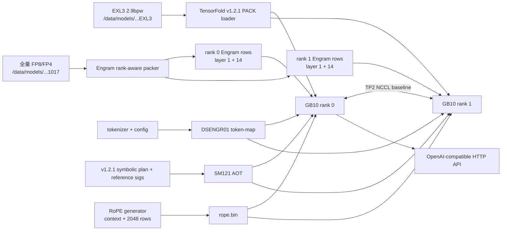

# TensorFold v1.2.1 原生双 GB10 启动方案

作者代码实际进入镜像的范围、未采用内容，以及本方案对既有 34+2 补丁决策的影响，见[作者方案参考内容与 v1.2.1 新部署方案影响分析](deepseek-v41-flash-1017-v121-author-reference-impact.md)。

## 1. 方案结论

本方案不复刻作者运行时 ABI。TensorFold v1.2.1 是唯一运行时基线，作者方案只提供性能思路和验证参考。

模型数据按职责拆分：

- `/data/models/DeepSeek-V4.1-Flash-1017-EXL3-2.9bpw`：作为 v1.2.1 `PACK`，提供量化后的主干、MoE、MTP/DSpark 等推理权重。
- `/data/models/DeepSeek-V4.1-Flash-1017`：只作为离线 Engram 源，读取两个 FP8 Engram embedding 表，生成 v1.2.1 原生 NVMe 行分片；它不参与在线 CUDA 主干加载。
- `TF_DSV41_ASSETS`：由 v1.2.1 工具生成 token-map、RoPE 和与精确启动 profile 匹配的 SM121 AOT。
- `TF_DSV41_ENGRAM_DIR`：每个节点只保存自己 TP rank 的 Engram 行分片。

因此，量化索引没有 `layers.*.engram.embed.*` 不是在线加载阻断；这些张量只需要存在于离线全量权重中，供 `tf-dsv41-engram-pack` 使用。

## 2. 已验证的数据事实

两台 GB10 节点的 `/data/models` 内容一致：

| 数据 | 大小 | 索引事实 | 用途 |
|---|---:|---|---|
| EXL3 2.9 bpw | 约 197 GiB，43 shards | `model_type=deepseek_v41`、`quant_method=exl3`、192495 keys | 在线 `PACK` |
| 全量 Flash-1017 | 约 476 GiB，48 shards | FP8/FP4 release、96085 keys | 离线 Engram 源 |
| layer 1 Engram | 384,006,168 rows | weight `F8_E4M3 [rows,256]`；scale `F8_E8M0 [rows,8]` | 生成行分片 |
| layer 14 Engram | 384,016,682 rows | weight `F8_E4M3 [rows,256]`；scale `F8_E8M0 [rows,8]` | 生成行分片 |

量化与全量目录除 `quantization_config` 外未发现配置差异；两边 `tokenizer.json` 和 `tokenizer_config.json` 的 SHA-256 分别完全一致。这意味着量化主干和全量 Engram 来自同一模型几何和 tokenizer，可作为混合来源，但仍必须在生成物 manifest 中记录两套来源哈希。

## 3. v1.2.1 原生数据流



## 4. 必须先完成的 v1.2.1 小范围开发

### 4.1 给 Engram packer 增加 TP rank/world 输出

当前 `tf-dsv41-engram-pack pack` 固定写 `engram-l<L>-r0of1.bin`，而在线 reader 按 `engram-l<L>-r<RANK>of<WORLD>.bin` 打开文件。需要新增：

```text
tf-dsv41-engram-pack pack RELEASE OUT \
  --layers 1,14 --rank R --world 2
```

实现要求：

1. 按完整表行数做无重叠、无空洞的连续切分。
2. rank 0 写 `[0, split)`，rank 1 写 `[split, total)`。
3. header 保持 `DSV41EN1`、真实 layer、lo、hi、total、row_bytes=264。
4. 输出文件名必须与 reader 一致。
5. `verify` 必须能验证指定 rank/world，并包含首行、末行和随机样本。
6. manifest 记录源 safetensors、源张量 offset/shape、rank/world、范围、文件大小及 SHA-256。

原因：TP rank 的 Engram hash 行空间本身按 head 分区；每个节点只需自己的连续行区间。直接生成 rank 分片可以把每节点 Engram 从完整约 202 GiB 降到约 101 GiB，也避免跨节点复制全表。

### 4.2 将资产工具加入准备镜像

最终运行镜像至少还需提供或配套一个同 commit 的 preparation image，包含：

- `tf-dsv41-token-map`
- `tf-dsv41-assets`
- `tf-dsv41-engram-pack`

原因：当前运行镜像只有 server/follower，不能从 `/data/models` 自助生成原生资产。准备工具必须与 server 来自相同 v1.2.1 commit，避免资产 ABI 漂移。

### 4.3 完善入口和预检

入口新增只读挂载 `/engram`，并设置 `TF_DSV41_ENGRAM_DIR=/engram`。预检必须验证：

- token-map 文件头为 `DSENGR01`；
- Engram 文件头为 `DSV41EN1`；
- 文件名、header rank/world、lo/hi/total 和实际文件大小一致；
- layer 1/14 均存在；
- rank 0/1 区间连续覆盖整表；
- 两节点 PACK、tokenizer、config、AOT manifest 的哈希一致；
- 每个节点只加载与 `TF_TP_RANK` 对应的 Engram 文件。

原因：TP 两端在 collective 前必须使用相同模型/profile；任一 Engram 分片错误都可能在另一 rank 已进入 collective 时造成挂起。

## 5. 资产生成步骤

以下路径是建议的新目录，不覆盖 `/data/models` 原始权重：

```text
/data/tensorfold-v121/dsv41/
  assets/profile-nccl-32k-s1-d0/
  engram/rank-0/
  engram/rank-1/
  manifests/
```

### 步骤 1：固定首启 profile

```text
world=2
context=32768
slots=1
parallel=1
drafts=0
prefill=默认 v1.2.1 路径
transport=NCCL
SM=121
```

原因：AOT needs、KV 规划、buffer plan 和图组合都受 profile 影响。先拿到最小正确性基线，再启用性能特性。

### 步骤 2：生成 token-map

使用全量目录的 tokenizer/config；两者与量化目录哈希一致：

```bash
tf-dsv41-token-map \
  --tokenizer /data/models/DeepSeek-V4.1-Flash-1017/tokenizer.json \
  --config /data/models/DeepSeek-V4.1-Flash-1017/config.json \
  --output /data/tensorfold-v121/dsv41/assets/profile-nccl-32k-s1-d0/engram-token-map.bin
```

原因：token-map 描述 token id 到 Engram hash 输入的规范映射，不是 Engram 权重本身；必须使用 v1.2.1 的 `DSENGR01` 生成器。

### 步骤 3：每节点本地生成 Engram rank 分片

rank 0 节点：

```bash
tf-dsv41-engram-pack pack \
  /data/models/DeepSeek-V4.1-Flash-1017 \
  /data/tensorfold-v121/dsv41/engram/rank-0 \
  --layers 1,14 --rank 0 --world 2
```

rank 1 节点：

```bash
tf-dsv41-engram-pack pack \
  /data/models/DeepSeek-V4.1-Flash-1017 \
  /data/tensorfold-v121/dsv41/engram/rank-1 \
  --layers 1,14 --rank 1 --world 2
```

然后分别执行 `verify`。原因：两台机器都已有全量权重，本地流式生成比通过网络搬运约 101 GiB 分片更简单，也不需要把 476 GiB 全量模型挂入在线容器。

### 步骤 4：生成 RoPE 和 AOT

`rope.bin` 必须覆盖 `context + 2048` 行。AOT 使用 v1.2.1 symbolic planner，在两个 rank 的相同 profile 下生成 needs，再由外部参考 Triton 工具针对 SM121 编译。

这里不能直接复用作者旧 AOT：作者 runtime、kernel signature 和 profile 与 v1.2.1 不同。当前仓库也不包含文档所指的外部 `triton_fill.py`/sigs 工具，因此这是首次启动前唯一需要补齐的外部工具链依赖。

### 步骤 5：生成统一 manifest 和哈希

manifest 至少记录：

- TensorFold commit、镜像 ID、CUDA/Zig/NVCC 版本、SM；
- 量化 PACK 的 config/index/tokenizer SHA-256；
- 全量 Engram 源的 config/index及两个源 shard SHA-256；
- token-map、RoPE、AOT、每 rank Engram 文件 SHA-256；
- world/context/slots/drafts/prefill/transport profile。

## 6. 首次启动参数

两个 rank 共同参数：

```text
TF_MODEL_DIR=/models/model
TF_DSV41_ASSETS=/assets
TF_DSV41_ENGRAM_DIR=/engram
TF_EXPERIMENTAL=deepseek
TF_TP_WORLD=2
TF_TP_PORT=29620
TF_TP_DEVICE=0
TF_TP_FAILFAST=1
TF_COMM_BACKEND=nccl
TF_CONTEXT=32768
TF_DSV41_CONTEXT=32768
TF_PARALLEL=1
TF_DSV41_SLOTS=1
TF_DSV41_DRAFTS=0
TF_DSV41_ENGRAM_PREFETCH=1
TF_REQUIRE_ASSET_HASHES=1
```

rank 1 先启动：

```bash
docker run -d --name tensorfold-dsv41-r1 \
  --gpus all --network host --ipc host \
  --ulimit memlock=-1 --ulimit stack=67108864 \
  -v /data/models/DeepSeek-V4.1-Flash-1017-EXL3-2.9bpw:/models/model:ro \
  -v /data/tensorfold-v121/dsv41/assets/profile-nccl-32k-s1-d0:/assets:ro \
  -v /data/tensorfold-v121/dsv41/engram/rank-1:/engram:ro \
  --env-file /data/tensorfold-v121/dsv41/rank-1.env \
  tensorfold-dsv41:v1.2.1-sm121
```

rank 0 在 follower 进入等待后启动：

```bash
docker run -d --name tensorfold-dsv41-r0 \
  --gpus all --network host --ipc host \
  --ulimit memlock=-1 --ulimit stack=67108864 \
  -v /data/models/DeepSeek-V4.1-Flash-1017-EXL3-2.9bpw:/models/model:ro \
  -v /data/tensorfold-v121/dsv41/assets/profile-nccl-32k-s1-d0:/assets:ro \
  -v /data/tensorfold-v121/dsv41/engram/rank-0:/engram:ro \
  --env-file /data/tensorfold-v121/dsv41/rank-0.env \
  tensorfold-dsv41:v1.2.1-sm121
```

rank 0 额外设置：

```text
TF_HTTP_HOST=0.0.0.0
TF_HTTP_PORT=8888
TF_SERVED_NAME=DeepSeek-V4.1-Flash-1017
TF_MAX_TOKENS=32768
TF_TEMPERATURE=1.0
TF_TOP_P=0.95
TF_TOP_K=20
TF_THINKING=1
```

## 7. 验收顺序

1. `engram-pack verify`：每 rank 首尾行及随机样本与全量源一致。
2. 两端 `TF_MODE=preflight`：文件、header、哈希、CUDA、NCCL 全通过。
3. rank 1 启动并进入 follower 等待。
4. rank 0 完成 PACK、AOT、KV、Engram 加载并监听 8888。
5. 非 thinking 与 thinking 各跑固定 prompt，记录 token ids、首 token 延迟、decode TPS 和 Engram I/O。
6. 注入 follower 停止，确认 rank 0 fail-fast，不无限等待。

只有第 4–6 步通过后才把状态提升为 integration verified。

## 8. 作者方案中可吸收的优化

以下只在 NCCL 正确性基线通过后逐项启用：

| 作者思路 | v1.2.1 对应能力 | 启用策略 |
|---|---|---|
| Engram 异步 I/O | io_uring；`TF_DSV41_ENGRAM_AIO`、`POLL`、`QD` | 先跑 `tf-dsv41 engram-probe`，选择实测最优模式 |
| Engram 预取 | `TF_DSV41_ENGRAM_PREFETCH`、`TF_DSV41_PREFETCH_AHEAD` | 先开同层预取，再测试跨 prefill segment read-ahead |
| CUDA graph cap | `TF_DSV41_GRAPHS_MAX`、`GRAPH_FLOOR_GIB`、`GRAPH_COST_MIB` | 以可用统一内存下限约束，不照抄作者 128 |
| side stream | `TF_DSV41_BRANCHES`、`MHC_DEFER` | 需要重新生成对应 AOT，逐组做 token parity |
| DSpark/drafts | v1.2.1 原生 DSpark、draft graph、depth calibration | 第二阶段打开，先验证 acceptance 和输出一致性 |
| RDMA | v1.2.1 `TF_COMM_BACKEND=roce`、multi-HCA、fast/chunked | NCCL 后切换；不移植旧 `tf-dsv41-lanes` RDMA ABI |
| plan link spin/pin | `TF_TP_PLAN_LINK=rdma`、`PLAN_SPIN_US`、`PLAN_PIN` | 仅在 CPU/延迟数据证明有收益时启用 |

作者的旧 rank-cache、kit、`engram-host.bin`、旧 AOT 和 `tf-dsv41-lanes` 命令不进入本方案。

## 9. 实施门槛

当前可立即使用的输入是 EXL3 PACK 和全量 Engram 源。真正启动前还需完成三项：

1. 实现并测试 rank-aware Engram packer；
2. 生成 v1.2.1 token-map、RoPE、SM121 AOT；
3. 更新镜像入口/预检并在两端完成资产校验。

这三项完成后无需修改 DeepSeek 主干模型计算路径，即可进入 TP2 NCCL 实际启动。
