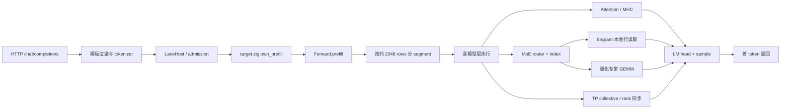

# DeepSeek V4.1 Flash 1017：TensorFold v1.2.1 Prefill 性能审计

## 1. 结论摘要

当前双 GB10、TP=2、本地 Engram 部署的 prefill 速度稳定在约 **127 token/s**，而作者“双机、本地 Engram”记录约为 **2,152 token/s**，差距约 **16.9 倍**。现有运行证据表明，主要耗时发生在 TensorFold 引擎内部的 GPU prefill 前向计算，而不是 HTTP、分词、NFS 或本地磁盘带宽：

- 1,987 token 请求的客户端 TTFT 为 15.702 秒，服务端 `prefill_seconds` 为 15.698 秒，二者只差约 4 毫秒。
- 8K 和 30K 请求保持约 127 token/s 的严格线性关系，说明每个约 2,048-row segment 都在重复承担约 16 秒的计算成本。
- 2K prefill 的硬件采样中，rank0 GPU SM 利用率连续保持约 96%；GPU 时钟约 2.56 GHz，高于作者锁定的 2.2 GHz，因此不是降频或 GPU 空闲等待。
- 同一时段本地 NVMe 约 68 MiB/s、利用率约 4.16%、读等待约 0.77 ms，磁盘未饱和。Engram 的非 io_uring 线程读取会增加 CPU/iowait，但无法单独解释 16.9 倍差距。
- 启动日志明确显示当前使用 `prefill full`，同时 `pf_dense off`、`R1 off`、`prefetch ahead off`、`x3gm v2 off`、`mhc pfdec 0`，并且 RoCE fast 与 Engram io_uring 均未启用。这是以正确性为先的保守路径，不是作者用于性能结果的优化路径。

因此，当前首要根因按优先级判断为：

1. **P0：优化 prefill GPU 路径没有启用或没有形成匹配的 AOT/kernel 组合。** 高置信度。
2. **P1：Engram 未使用 io_uring/AIO 与预取，增加了 CPU 和 I/O 等待。** 中等置信度，属于次要放大因素。
3. **P1：TP 通信运行在 NCCL socket 路径，未启用作者配置中的 RoCE/通信重叠。** 中等置信度，属于每层同步的次要放大因素。
4. **P2：draft、CUDA graph 未启用。** 这是 decode 差距的重要候选，但不是当前 17 倍 cold prefill 差距的首要解释。

本轮只做诊断和文档固化，没有修改推理代码、环境变量或重启服务。

## 2. 测试边界与可比基线

比较必须使用作者“Engram 位于两台机器本地磁盘”的记录，不能使用 NFS Engram 数据。

| 项目 | 当前 v1.2.1 | 作者本地 Engram | 差异 |
|---|---:|---:|---:|
| 8K prefill | 127.58 token/s，TTFT 61.67 s | 2,152.0 token/s，TTFT 3.99 s | 吞吐约 -94.1%，约慢 16.9 倍 |
| 30K/32K prefill | 127.62 token/s，TTFT 225.26 s | 2,153.6 token/s，TTFT 15.40 s | 吞吐约 -94.1%，约慢 16.9 倍 |
| 单流 decode | 14.42 token/s | prose 80.7 / code 118.1 token/s | decode 另行分析 |

当前与作者环境仍存在配置差异，因此上述结果用于定位性能路径，不等同于完成严格同配置复现。当前已确认的主要差异包括 drafts、graphs、side stream/prefetch、Engram AIO、RoCE、context 和优化 kernel knobs。

## 3. 实际请求到首 token 的运行链路



代码路径的关键锚点如下：

- `serve_engine.zig:78`：打开模型，并把 `own_prefill` 配置交给模型。
- `target.zig:112-115`：own-prefill 请求调用 `f.prefill(rest)`，随后读取实际 segment rows。
- `sched_host.zig:49`：调度器使用 `forward_prefill.zig` 的 `segmentRows`。
- `forward_prefill.zig`、`block_prefill.zig`：把长 prompt 按 prefill rows 分段，执行完整模型层前向。
- `block_prefill_attn.zig`、`block_prefill_moe.zig`、`block_index.zig`、`block_prefetch.zig`：分别承载 attention、MoE、索引与预取相关子路径。
- `engram_rows_linux.zig`、`engram_io.zig`：Engram 行读取和 Linux I/O 路径。
- `serve_knobs.zig:251-257`：`TF_DSV41_PREFILL` 选择 `full` 或 `replay`；未设置时为 `full`。
- `profile.zig`：支持通过 `TF_DSV41_PROFILE` 生成细粒度 GPU profile，但需要受控重启并在服务关闭时落盘，本轮未启用。

启动日志中的“prompt chunks of up to 16 tokens”是上层 lane/batcher 的调度提示，不代表模型在用 16-token decode window 逐段处理整个 prompt。实际 own-prefill 路径仍使用 `forward_prefill` 的约 2,048-row segment。请求耗时对 token 数量严格线性，也与这一执行方式一致。

## 4. 实测耗时归属

### 4.1 客户端与服务端计时

| prompt tokens | 客户端 TTFT | 服务端 prefill | 近似吞吐 | 结论 |
|---:|---:|---:|---:|---|
| 1,987 | 15.7019 s | 15.6983 s | 126.6 token/s | HTTP、分词和响应封装合计约毫秒级 |
| 1,975 | 15.5907 s | 约 15.59 s | 126.7 token/s | 2K 重复样本一致 |
| 7,869 | 61.6778 s | 约 61.68 s | 127.6 token/s | 约四个 segment 线性累加 |
| 7,865 | 61.6234 s | 约 61.62 s | 127.6 token/s | 8K 重复样本一致 |
| 28,738 | 225.1085 s | 约 225.11 s | 127.7 token/s | 30K 仍无吞吐提升 |
| 28,759 | 225.3245 s | 约 225.32 s | 127.6 token/s | 30K 重复样本一致 |

服务累计指标同样给出：

```text
scheduler_tokens_total{mode="prefill_compute"} = 126574
prefill_busy_seconds_total = 995.63819056
126574 / 995.63819056 = 127.12 token/s
```

这证明低吞吐不是单次冷启动噪声，而是当前 prefill 计算路径的稳定工作速率。

### 4.2 2K prefill 硬件采样

| 观测项 | 实测 | 含义 |
|---|---:|---|
| GPU SM utilization | 连续约 96% | GPU 在整个 prefill 中持续执行计算，不是大段等待 HTTP 或磁盘 |
| GPU graphics clock | 约 2,561-2,567 MHz | 高于作者记录的锁定 2,200 MHz；降频不是根因 |
| NVMe read throughput | 约 68 MiB/s | 对本地 NVMe 很低 |
| NVMe utilization | 约 4.16% | 磁盘没有达到带宽或队列上限 |
| NVMe read await | 约 0.77 ms | 单次读延迟较低 |
| CPU iowait | 约 9.66% | 非 AIO/线程读取有可见代价，但 GPU 同时保持繁忙 |
| CPU system | 约 11.42% | 线程读取、调度或通信存在额外 CPU 开销 |

GPU 高占用不能自动证明 kernel 高效。相反，“SM 持续繁忙但仅 127 token/s”说明当前 kernel 组合很可能在执行大量低效率、未融合、较低 tensor-core 利用率或频繁同步的工作。这与多个优化开关关闭的启动日志相符。

## 5. 根因排序

### 5.1 P0：当前落在保守 full-prefill GPU 路径

**证据：** 启动日志为 `prefill full`，并明确显示 `pf_dense off`、`R1 off`、`prefetch ahead off`、`x3gm v2 off`、`mhc pfdec 0`。GPU 在 prefill 时持续约 96% 忙碌，且吞吐对 prompt 长度完全线性。

**模型架构关联：** DeepSeek V4.1 Flash 的每层不仅包含 attention，还包含大规模稀疏 MoE 路由、expert 选择和量化矩阵乘。prefill 将大量 rows 同时送入这些节点，只有使用适合长行批次的融合/分块 kernel 才能获得高吞吐。`x3gm v2`、prefill dense 路径、R1/replay/CED、MHC prefill/decode 合并等开关直接关联这些计算节点。

**TensorFold 特性关联：** v1.2.1 同时保留 full、replay/CED、不同 segment rows、x3gm 和预取路径。这说明“代码中存在能力”不等于“当前镜像运行时已经选择该能力”。AOT 也必须包含相同 knobs 下的 program/shape；只改环境变量而没有匹配 AOT 可能失败或回退。

**为什么是首要原因：** 磁盘未饱和、GPU 没有降频、请求层开销只有毫秒，而每个约 2K segment 固定消耗约 16 秒。剩余的主要时间只能落在 GPU kernels、层间同步及其调用组合上。

### 5.2 P1：Engram AIO 和预取关闭

**证据：** 日志显示 `no io_uring (PermissionDenied)`、线程读取，以及 `prefetch ahead off`。采样存在约 9.66% CPU iowait。

**模型架构关联：** Engram 节点依赖 token hash 定位本地大表行。在每个相关层中，如果下一批行未提前进入内存/设备，host 读取和 staging 会进入前向关键路径。

**TensorFold 特性关联：** `engram_rows_linux.zig`、`engram_io.zig` 和 `block_prefetch.zig` 提供 Linux I/O 与预取路径；当前容器权限或运行设置使其退回线程读取。

**为什么不是 P0：** NVMe 利用率仅约 4%、await 亚毫秒，且 GPU SM 全程约 96%。即使 AIO 能减少 host 开销，也不太可能单独带来 16.9 倍提升。

### 5.3 P1：TP 使用 socket，RoCE fast/通信重叠关闭

**证据：** 当前日志显示 NCCL socket 路径和 `roce fast off`，作者性能配置启用 RDMA/RoCE。

**模型架构关联：** TP=2 会在层内投影、expert 输出或 residual 汇合处产生 rank 间 collective。DeepSeek 的高层数让单层额外延迟被重复放大。

**TensorFold 特性关联：** v1.2.1 具有 TP、NCCL、RoCE 和分片 KV/通信能力，但当前正确性基线有意使用 socket。需要在 kernel 主路径确认后单变量切换，不能把通信优化和计算优化混为一个实验。

**为什么不是唯一主因：** 单纯从以太网 socket 切到 RoCE 通常无法解释 17 倍端到端差距；而且当前 GPU 始终高占用，更符合计算 kernel 低效并叠加同步开销。

### 5.4 P2：draft 与 CUDA graph 主要影响 decode

作者配置启用 drafts 和 graphs，当前 `TF_DSV41_DRAFTS=0`。这对 14.42 token/s 的 decode 差距非常重要，但 cold prefill 仍需完整吸收 prompt，draft 不会把 2K/8K/30K 主模型前向直接缩短 17 倍。CUDA graph 可减少 launch overhead，但当前每段约 16 秒，也不符合“纯 launch overhead”是唯一主因的量级。

## 6. 已排除或降级的候选原因

| 候选 | 判断 | 原因 |
|---|---|---|
| NFS 读取 Engram | 排除 | 两台机器均从本地磁盘读取，满足当前比较前提 |
| HTTP / SSE / tokenizer | 排除为主因 | 客户端 TTFT 与服务端 prefill 只差毫秒级 |
| 本地 NVMe 带宽饱和 | 排除为主因 | 约 68 MiB/s、4.16% util、0.77 ms await |
| GPU 降频或热限频 | 排除 | 当前约 2.56 GHz，高于作者锁定 2.2 GHz，未见 thermal/power violation |
| 16-token chunk 逐段 decode | 排除 | own-prefill 实际进入约 2,048-row segment 路径 |
| context=32768 本身 | 降级 | 会改变 KV/index 规模，但不足以解释稳定 17 倍差距；仍需同配置 A/B |
| Engram 数据错误 | 排除 | 修复后两 rank 各回读 200,004 rows、0 differ，运行无越界和重启 |

## 7. 下一步受控剖析与 A/B 顺序

下一阶段的目标不是一次性打开作者全部参数，而是找到每个约 2,048-row segment 的 GPU 时间归属，并保持输出 token digest/parity 不变。

### 步骤 1：获得 per-op GPU profile

在维护窗口临时设置 `TF_DSV41_PROFILE=<file>`，只运行一个固定 salt 的 2K 请求，随后正常关闭服务以写出 profile。按 attention、MoE/x3gm、index、Engram wait、collective 和 head 汇总 GPU 时间。

**原因：** 当前只能确定“GPU prefill 路径慢”，尚不能客观分配到各 kernel。该 profile 是决定移植或启用哪项能力的最直接证据。

**通过条件：** profile 中各 op 时间之和能覆盖大部分约 15.7 秒 prefill，并可定位前三个热点。

### 步骤 2：优化 prefill kernel + 匹配 AOT

优先验证 x3gm v2、prefill dense 路径，以及与当前量化 pack/SM121 对应的 AOT。每次只改变一组存在依赖关系的 knobs，并重新生成/核对 AOT needs。

**原因：** 这是与 GPU 96% 忙碌和保守路径日志最一致的主因。

**通过条件：** 2K 相同输入 token digest 一致、无 fallback/error，segment 时间显著下降。阶段目标先达到低于 1.3 秒（约 1,500 token/s），最终接近 0.95 秒（约 2,100 token/s）。

### 步骤 3：replay/CED、R1 与相关融合路径

在步骤 2 稳定后，验证 `TF_DSV41_PREFILL=replay` 及其对应的 R1/MHC/decoder replay 组合，并补齐相同形状的 AOT。

**原因：** 这些设置共同改变 prompt 的 encoder/decoder 工作划分，不能随意拆散或与缺失 AOT 的镜像混用。

**通过条件：** 正确性与 full mode 一致，2K、8K 吞吐均提升，且 8K 不出现额外线性惩罚。

### 步骤 4：Engram AIO 与 prefetch ahead

解决容器内 io_uring 权限或限制，先运行 Engram probe，再单独启用 AIO、prefetch ahead，记录 CPU iowait、NVMe await 和 GPU idle/overlap。

**原因：** 当前 I/O 不是首要瓶颈，但在 kernel 提速后可能上升为新的关键路径；提前混入会掩盖 GPU 路径收益。

**通过条件：** 无权限回退日志，CPU iowait 降低，prefill 不回退且 token parity 保持。

### 步骤 5：RoCE 与通信重叠

在计算路径和本地 I/O 已稳定后，将 NCCL socket 切换为严格 RoCE，分别采集两 rank 的 collective 时间。

**原因：** 这样才能量化每层 TP 同步的真实贡献，并将网络收益与 kernel 收益分开。

**通过条件：** 两 rank 均确认走 RoCE；collective 时间下降；无 silent socket fallback；2K/8K/30K 均无正确性回归。

### 步骤 6：最后处理 decode 专项

再启用 CUDA graph、draft、side stream 和 decode 专用 R1/融合能力，复跑作者 decode workload。

**原因：** 这些能力是 decode 从 14.42 token/s 接近作者 80.7/118.1 token/s 的主要候选，不应干扰首轮 prefill 根因实验。

## 8. 性能验收建议

每轮 A/B 固定：相同模型与 Engram 哈希、相同 prompt token ids、相同 salt、单并发、相同 segment rows、相同上下文上限。至少记录：

- 服务端 `prefill_seconds`、`time_to_first_token`；
- `scheduler_tokens_total{mode="prefill_compute"}` 与 `prefill_busy_seconds_total`；
- per-op GPU profile；
- 两 rank GPU SM/clock/power；
- NVMe throughput/util/await 与 CPU iowait；
- NCCL transport 和 collective 时间；
- 首 token 与完整输出 token digest；
- 容器 restart count 和两 rank 错误日志。

只有在 2K 显著提速后，才扩展到 8K、30K。若 2K 提速但 8K/30K 不保持比例，应优先检查 segment 间同步、Engram 预取窗口、KV/index 增长和 collective 累加，而不是先调整 decode 参数。

## 9. 当前判断的证据强度

| 判断 | 置信度 | 尚缺证据 |
|---|---|---|
| 时间主要消耗在引擎内部 prefill | 高 | 无 |
| 本地 NVMe 不是当前主瓶颈 | 高 | rank1 同步采样可进一步确认，但不影响主判断 |
| GPU kernel/调用组合是首要瓶颈 | 高 | 缺 per-op GPU profile 来细分热点 |
| 非 AIO/无预取是次要放大因素 | 中 | 需要 AIO 单变量 A/B |
| socket TP 是次要放大因素 | 中 | 需要 NCCL collective profile 与 RoCE A/B |
| drafts/graphs 不是 prefill 首因 | 中高 | CUDA graph 单变量测试可量化 launch 占比 |

当前可以确定的是“慢在 GPU prefill 主链路”；尚不能在没有 `TF_DSV41_PROFILE` 的情况下武断声称某一个具体 kernel 占用了全部 15.7 秒。下一步应先做一次受控 profile，再决定最小代码或配置调整集合。
